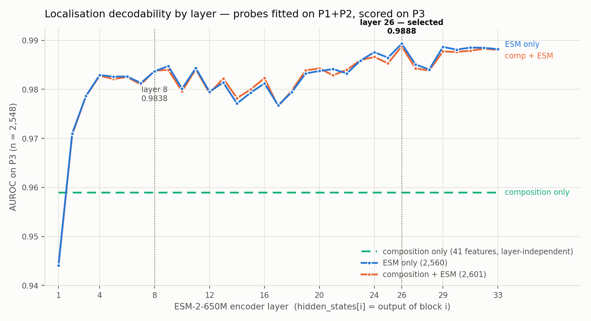

# Layer Sweep — Interpretation of the Saved Results

**Scope:** clarification of the completed sweep from saved outputs only. No extraction, no
refitting, no change to the layer selection, no family analysis, no P0 access, no embeddings
deleted, not committed, not pushed. The only new artifact is the figure in §3, rendered from
[`p3_layer_curves.tsv`](layer_sweep/v1/p3_layer_curves.tsv).

Companion: [`LAYER_SWEEP_REPORT.md`](LAYER_SWEEP_REPORT.md) · protocol
[`frozen_protocol.json`](layer_sweep/v1/frozen_protocol.json).

---

## 1. The exact results

**Populations.** Probes fitted once on **P1+P2 = 5,190** proteins (eligible core, `in_core==1`).

| Split | n | Extracellular | Cytoplasm | Prevalence |
|---|---|---|---|---|
| Fit (P1+P2) | 5,190 | 1,336 | 3,854 | 0.2574 |
| **P3** (layer comparison) | **2,548** | **584** | **1,964** | 0.2292 |
| **P4** (evaluation) | **2,366** | **571** | **1,795** | 0.2413 |

**Metrics.** P3 from [`p3_layer_curves.tsv`](layer_sweep/v1/p3_layer_curves.tsv); P4
protein-weighted from [`p4_results.tsv`](layer_sweep/v1/p4_results.tsv), subset `P4_all`.

| Model | Features | P3 AUROC | P3 AP | P4 AUROC | P4 AP |
|---|---|---|---|---|---|
| Composition only | 41 | 0.958956 | 0.884942 | 0.969604 | 0.918208 |
| Layer 8, ESM only | 2,560 | 0.983695 | 0.955781 | 0.961187 | 0.939785 |
| Layer 8, composition + ESM | 2,601 | 0.983810 | 0.953372 | 0.962811 | 0.940561 |
| Layer 26, ESM only | 2,560 | **0.989305** | 0.964574 | **0.982902** | **0.963673** |
| Layer 26, composition + ESM | 2,601 | 0.988768 | 0.963146 | 0.982912 | 0.962414 |

The composition model is layer-independent, so one row serves both layers. All 99 P3 fits and
6 P4 fits converged (max `n_iter` 159 of 5,000); 0 non-finite values across 397 stored arrays.

### Selection

> **Feature set:** `comp_plus_esm`. **Metric:** AUROC on **P3**. **Tie-break:** lower layer
> index. **Result:** layer **26** (0.988768); layer 8 was 0.983810.

**Confirmed saved before any P4 prediction**, on three independent pieces of evidence:

1. [`layer_selection.json`](layer_sweep/v1/layer_selection.json) carries
   `"frozen_before_any_P4_prediction": true`.
2. Program order in [`run_sweep_v2.py`](layer_sweep/run_sweep_v2.py): the file is written and
   `os.fsync`'d, and only afterwards is the first P4 feature matrix constructed.
3. Run log [`sweep_v2_resume.log`](layer_sweep/v1/sweep_v2_resume.log): the
   `*** SELECTION FROZEN ***` line precedes the first P4 line
   (`P4 n=2366 clusters=1547 …`).

---

## 2. The headline comparisons resolved

### 2.1 Which comparison produced +0.0133

**Two comparisons both round to +0.0133**, and the report's §5.2 conclusion quoted the second.
Both are on subset `P4_all`, protein-weighted:

| Comparison | Model A | Model B | ΔAUROC (exact) | 95 % CI |
|---|---|---|---|---|
| `layer26_comp_plus_esm_vs_comp` | 0.982912 | 0.969604 | **+0.013308** | [+0.004635, +0.023672] |
| `layer26_esm_vs_comp` | 0.982902 | 0.969604 | **+0.013298** | [+0.004658, +0.023729] |

They differ by 1.0 × 10⁻⁵ because adding the 41 composition features to the layer-26 embedding
changes almost nothing. **The quoted +0.0133 is `layer26_esm_vs_comp`** (ESM-only at layer 26
versus the composition baseline), ΔAUROC = **+0.013298**, ΔAP = **+0.045465**
[+0.020891, +0.086497].

Full specification of that comparison:

| Property | Value |
|---|---|
| Underlying scores | layer-26 ESM AUROC **0.982902**; composition AUROC **0.969604** |
| Paired difference | **+0.013298** AUROC · **+0.045465** AP |
| Confidence level | **95 %**, percentile |
| Interval | AUROC [+0.004635, +0.023729]* · AP [+0.020891, +0.086497] |
| Resampling | **paired cluster bootstrap**, 30 %-identity clusters drawn whole with replacement, B = 10,000, seed 42; the *same* resample indices for both models so per-protein pairing is preserved |
| Mixed-class clusters | kept intact, never split; resampling unstratified |
| Undefined resamples | **0** excluded |
| Weighting | **protein-weighted** (primary) |
| Subset | `P4_all`, n = 2,366, 1,547 clusters |
| Multiplicity | **none prespecified, none applied** — see below |

*the exact bound for `layer26_esm_vs_comp` is +0.004658; the table above gives each row's own.

> **Multiplicity disclosure.** The frozen protocol specifies a percentile 95 % CI per
> comparison and prescribes **no multiplicity adjustment**. Fifteen P4 comparisons were
> computed (5 per subset × 3 subsets). The intervals are therefore **unadjusted**, and this
> differs from the intervention analysis, which retained a Bonferroni level of 98.75 % for its
> four contrasts. No adjustment was applied retrospectively, because doing so would not have
> been prespecified.

### 2.2 The corresponding layer-8 and layer-26-versus-layer-8 comparisons

Subset `P4_all`, protein-weighted, same bootstrap:

| Comparison | ΔAUROC | 95 % CI | Excludes 0 | ΔAP | 95 % CI | Excludes 0 |
|---|---|---|---|---|---|---|
| Layer 8 `esm` vs composition | **−0.008417** | [−0.048621, +0.017190] | no | +0.021577 | [−0.014287, +0.070845] | no |
| Layer 8 `comp_plus_esm` vs composition | −0.006794 | [−0.044584, +0.017806] | no | +0.022354 | [−0.013102, +0.072298] | no |
| **Layer 26 vs layer 8** (`comp_plus_esm`, same feature set) | **+0.020102** | [−0.003503, +0.063002] | **no** | +0.021853 | [−0.006598, +0.065666] | no |

### 2.3 "Interval includes zero" is not evidence of equivalence

Three of the comparisons above have intervals containing zero. That means the data are
**compatible with no difference** — it does **not** mean the models perform equally.

- The layer-26-versus-layer-8 interval runs from **−0.0035 to +0.0630**. It is compatible with
  layer 8 being very slightly better *and* with layer 26 being substantially better. An
  equivalence claim would require a prespecified margin and an interval contained **inside**
  it; no such margin was specified, and this interval is far too wide to satisfy any plausible
  one.
- The layer-8-versus-composition interval ([−0.0486, +0.0172]) is likewise wide and asymmetric
  about a negative point estimate. The correct reading is **"not established in either
  direction"**, not "the same".
- Only the two layer-26-versus-composition comparisons have intervals excluding zero.

---

## 3. The layer curve

Figure: [light](layer_sweep/v1/fig_p3_layer_curve_light.png) ·
[dark](layer_sweep/v1/fig_p3_layer_curve_dark.png) ·
[SVG](layer_sweep/v1/fig_p3_layer_curve_light.svg) · source
[`plot_layer_curve.py`](layer_sweep/plot_layer_curve.py), reading only
[`p3_layer_curves.tsv`](layer_sweep/v1/p3_layer_curves.tsv).

Per-layer P3 AUROC, `comp_plus_esm`. Composition baseline = 0.958956 (flat).

| L | AUROC | L | AUROC | L | AUROC |
|---|---|---|---|---|---|
| 1 | 0.943926 | 12 | 0.979161 | 23 | 0.986035 |
| 2 | 0.970818 | 13 | 0.982185 | 24 | 0.986619 |
| 3 | 0.978574 | 14 | 0.978200 | 25 | 0.985320 |
| 4 | 0.982794 | 15 | 0.979953 | **26** | **0.988768** |
| 5 | 0.982102 | 16 | 0.982290 | 27 | 0.984298 |
| 6 | 0.982469 | 17 | 0.976520 | 28 | 0.983820 |
| 7 | 0.981034 | 18 | 0.979761 | 29 | 0.987715 |
| **8** | **0.983810** | 19 | 0.983881 | 30 | 0.987635 |
| 9 | 0.983984 | 20 | 0.984289 | 31 | 0.987872 |
| 10 | 0.979631 | 21 | 0.982851 | 32 | 0.988278 |
| 11 | 0.984080 | 22 | 0.983999 | 33 | 0.988040 |

### Broad region, not an isolated peak

| Window around the maximum (0.988768) | Layers inside |
|---|---|
| within 0.001 | **4** — 26, 31, 32, 33 |
| within 0.002 | 6 — 26, 29, 30, 31, 32, 33 |
| within 0.005 | **17** — including **layer 8** |
| within 0.010 | 28 of 33 |

Over layers 4–33 the entire spread is **0.012248** AUROC. Layer 26's margin over the
second-placed layer 32 is **0.000490**; over layer 8 it is **0.004958**.

**Layer 26 is a local maximum sitting inside a broad high-performing region, not an isolated
peak.** Three further observations, all descriptive:

- **Layer 1 is below the composition baseline** (0.943926 vs 0.958956). Decodability rises
  steeply over layers 2–4, then plateaus.
- **The ordering is metric-dependent.** By AUROC the maximum is layer 26 (AP 0.963146). By
  **average precision** the maximum is **layer 33** (AP 0.969453, AUROC 0.988040). Had AP been
  the frozen criterion, a different layer would have been selected.
- **`esm` and `comp_plus_esm` track each other closely at every layer** — the two lines in the
  figure are nearly coincident above layer 3.

> **No superiority is established by this ranking.** These are single-split point estimates on
> P3 with **no confidence intervals computed per layer** — the P3 curve was used solely to
> apply the prespecified selection rule. Differences of 0.0005 to 0.005 between neighbouring
> layers are reported as observed values and should not be read as demonstrating that one
> layer is better than another.

---

## 4. Robustness of the P4 comparisons

All from [`p4_results.tsv`](layer_sweep/v1/p4_results.tsv) and
[`p4_cluster_bootstrap.tsv`](layer_sweep/v1/p4_cluster_bootstrap.tsv).

| Subset | n | Extracellular | Cytoplasm | Clusters | Largest cluster |
|---|---|---|---|---|---|
| **`P4_all`** — frozen primary | 2,366 | 571 | 1,795 | 1,547 | `Q2VBP4` 93 (3.93 %) |
| `P4_excl_fitting_set_cluster_overlap` — sensitivity | 2,344 | 566 | 1,778 | 1,533 | `Q2VBP4` 93 (3.97 %) |
| `P4_excl_toxin_cluster_Q2VBP4` — sensitivity | 2,273 | 478 | 1,795 | 1,546 | `O00755` 23 (1.01 %) |

### 4.1 Protein weighting versus equal-cluster weighting — **the one axis that changes a sign**

Subset `P4_all`. Equal-cluster weighting gives each protein weight 1/(its cluster's size in the
evaluated set), so every cluster contributes total weight 1.

| Model | AUROC protein-wt | AUROC equal-cluster | AP protein-wt | AP equal-cluster |
|---|---|---|---|---|
| Composition | 0.969604 | **0.963758** | 0.918208 | **0.883342** |
| Layer 8 ESM | 0.961187 | **0.973715** | 0.939785 | 0.939430 |
| Layer 8 comp+ESM | 0.962811 | **0.974618** | 0.940561 | 0.940554 |
| Layer 26 ESM | 0.982902 | 0.978368 | 0.963673 | 0.942172 |
| Layer 26 comp+ESM | 0.982912 | 0.979414 | 0.962414 | 0.941969 |

Under protein weighting layer-8 ESM is **below** the composition baseline (−0.0084); under
equal-cluster weighting it is **above** it (0.973715 vs 0.963758, +0.0100). **The sign of the
layer-8 ESM-versus-composition comparison depends on the weighting.** The composition baseline
is the model that loses most when clusters rather than proteins are given equal weight.

> Equal-cluster weighting is an **explicitly labelled sensitivity analysis**. The frozen
> primary is protein-weighted. No bootstrap interval was computed under equal-cluster
> weighting — the protocol specifies the paired cluster bootstrap on the protein-weighted
> metric, so the figures above are point estimates only.

### 4.2 Excluding proteins sharing a cluster with the fitting set (22 of 2,366) — **negligible**

| Comparison | `P4_all` ΔAUROC [95 % CI] | Excl. overlap ΔAUROC [95 % CI] |
|---|---|---|
| L26 `esm` vs comp | +0.013298 [+0.004658, +0.023729] | **+0.014750 [+0.006375, +0.025044]** |
| L26 `comp_plus_esm` vs comp | +0.013308 [+0.004635, +0.023672] | +0.014749 [+0.006406, +0.024943] |
| L8 `esm` vs comp | −0.008417 [−0.048621, +0.017190] | −0.008089 [−0.049188, +0.017598] |
| L8 `comp_plus_esm` vs comp | −0.006794 [−0.044584, +0.017806] | −0.006523 [−0.045127, +0.018127] |
| L26 vs L8 `comp_plus_esm` | +0.020102 [−0.003503, +0.063002] | +0.021272 [−0.002418, +0.064362] |

Every conclusion is unchanged; the layer-26 advantage strengthens marginally.

### 4.3 Excluding the toxin cluster `Q2VBP4` (93 proteins, all Extracellular) — **sensitivity**

| Comparison | ΔAUROC [95 % CI] | ΔAP [95 % CI] |
|---|---|---|
| L26 `esm` vs comp | **+0.015592 [+0.005348, +0.025820]** | **+0.066984 [+0.041597, +0.094648]** |
| L26 `comp_plus_esm` vs comp | +0.015664 [+0.005450, +0.025824] | +0.065353 [+0.040182, +0.092647] |
| L8 `esm` vs comp | −0.010137 [−0.055596, +0.019318] | +0.038517 [−0.010996, +0.079653] |
| L8 `comp_plus_esm` vs comp | −0.008043 [−0.051257, +0.019934] | +0.040792 [−0.007767, +0.081650] |
| L26 vs L8 `comp_plus_esm` | +0.023707 [−0.004503, +0.069603] | +0.024561 [−0.010163, +0.075511] |

Removing the cluster drops the composition baseline's AP from 0.918208 to 0.880813 and widens
layer 26's AP advantage from +0.045 to +0.067. Conclusions do not flip. **This is a sensitivity
analysis, not a replacement primary result.**

**Summary across all three axes:** the layer-26-versus-composition result holds in every
subset; the layer-8-versus-composition result is not established in any subset under protein
weighting but reverses sign under equal-cluster weighting; the layer-26-versus-layer-8
interval includes zero in all three subsets.

---

## 5. Reconciliation with the earlier four-fold result (0.9610 → 0.9789)

The archived figure is from [`DeepLoc2/rerun/esm2_probe/deeploc_esm_results.tsv`](DeepLoc2/rerun/esm2_probe/deeploc_esm_results.tsv):
`matched_C` mean AUROC **0.9610** → `c_matchedC_plus_ESM` **0.9789** (Δ +0.0179), AP 0.8903 →
0.9537, at layer 8. The nearest comparison here is layer-8 composition → composition+ESM:
**0.958956 → 0.983810 on P3** (Δ +0.0249) and **0.969604 → 0.962811 on P4** (Δ −0.0068).

> **This sweep is not a direct replication.** The archived number is an unweighted mean of four
> per-fold AUROCs covering all 10,139 development proteins out-of-fold; the sweep's numbers are
> single-split AUROCs from one fit. They are different estimators of different quantities.

### Verified differences

| Dimension | Archived four-fold | This sweep | Verified from |
|---|---|---|---|
| **Population** | 10,139 (all development) | **10,104** (eligible core; −8 `E1_engineering_protein`, −27 `E2_p0_base_collision`) | `inclusion_manifest.tsv`; 8 of the 35 fall in P3, 16 in P4 |
| **Fitting design** | 4 fits, each on 3 partitions | **1 fit** on P1+P2 | scripts |
| **Training size** | 7,428 – 7,757 per fold | **5,190** | partition counts above |
| **Evaluation** | every protein scored out-of-fold; reported as the unweighted mean of 4 fold AUROCs | single held-out split: P3 (2,548) or P4 (2,366) | results files |
| **Scaler fitting** | `StandardScaler` on each fold's 3 training partitions | `StandardScaler` on P1+P2 only | both train-only; no leakage either way |
| **Estimator** | `l2`, C=1.0, `lbfgs`, `max_iter=5000`, `random_state=42` | **identical** | [`probe_deeploc.py:87-88`](DeepLoc2/esm2_probe/probe_deeploc.py#L87-L88) vs `run_sweep_v2.py` |
| **Feature definitions** | `matched_C` = 41; `c_matchedC_plus_ESM` = 41 + whole + nterm | **identical** (`comp`, `comp_plus_esm`) | side-by-side in `frozen_protocol.json` |
| **Truncation / pooling / N-term window** | 1,022 · residue-token mean, `<cls>`/`<eos>`/padding excluded · 30 | **identical** | extraction metadata, both files |
| **Checkpoint / device / library versions** | `esm2_t33_650M_UR50D`, MPS, torch 2.8.0, transformers 4.57.6 | **identical** | extraction metadata |
| **Pooling location** | residue activations transferred to CPU, pooled there in float32 | **pooled on device** in float32, then transferred | metadata `pooling_device` |
| **Stored precision** | **float32** | **float16** | metadata `stored_dtype` |
| **Prediction storage** | 6 decimal places in the OOF TSV | float32 arrays in `.npz` | [`probe_deeploc.py:97`](DeepLoc2/esm2_probe/probe_deeploc.py#L97) |

Two numerical differences were measured during the pilot
([`resource_check.json`](layer_sweep/v1/resource_check.json)): the on-device-versus-CPU pooling
difference gave a minimum cosine similarity of **0.9999996** against the archived layer-8
vectors, and float16 storage a minimum per-layer cosine of **0.9999996**. Both are recorded;
neither was shown to drive any result.

> **No causal attribution is made.** Several things differ at once — population, training size,
> fitting design, evaluation split, and numerical precision — and **none of them has been
> separately tested** as the cause of the changed layer-8 performance. The difference between
> the P3 value (+0.0249) and the P4 value (−0.0068) for the same fitted probes shows that the
> **evaluation split alone** moves this comparison substantially, but that observation
> identifies a contributor, not the explanation.

---

## 6. Plain-language conclusion

**What the sweep establishes.**

1. Localisation is decodable from frozen ESM-2 representations across almost the whole network.
   Above layer 3 every layer beats a 41-feature amino-acid-composition baseline on P3, and the
   spread across layers 4–33 is only 0.012 AUROC.
2. Under the prespecified rule — highest P3 `comp_plus_esm` AUROC, lower index breaking ties —
   **layer 26** is selected, and that choice was frozen before any P4 number existed.
3. **At layer 26, ESM carries information beyond amino-acid composition.** On P4 the gain is
   +0.0133 AUROC [+0.0046, +0.0237] and +0.0455 AP [+0.0209, +0.0865], and it survives both
   sensitivity subsets, strengthening when the toxin cluster is removed.

**What it leaves unanswered.**

1. **Whether layer 26 is genuinely better than layer 8.** Their P4 difference is +0.0201 with a
   95 % interval of [−0.0035, +0.0630] — compatible with no difference and with a large one.
   This is *not* evidence of equivalence.
2. **Whether layer 8 adds anything over composition.** Protein-weighted, the point estimate is
   negative and the interval spans zero; equal-cluster-weighted, the ordering reverses. The
   answer depends on a weighting choice that the data cannot adjudicate.
3. **Which layer is "best".** AUROC selects layer 26, average precision selects layer 33, and
   17 layers lie within 0.005 of the maximum. The selection rule produced an answer; the data
   do not single out a layer.
4. **Why layer 8 behaves differently here than in the four-fold analysis.** Five verified
   differences exist and none has been isolated.
5. **What ESM actually encodes.** A linear probe recovers what is linearly available in a
   pooled vector. That is equally consistent with a direct targeting-signal representation,
   with a diffuse compositional correlate, and with something merely co-varying with
   localisation such as protein family.

> **Two boundaries this document does not cross.** The best probe layer is **not** thereby the
> best intervention layer — decodability and intervention effects are different measurements,
> and nothing here nominates a layer for intervention. And **no result here establishes direct
> encoding.** §1.4 of [`LOCALISATION_EXPERIMENT_SPEC.md`](LOCALISATION_EXPERIMENT_SPEC.md)
> applies unchanged.
