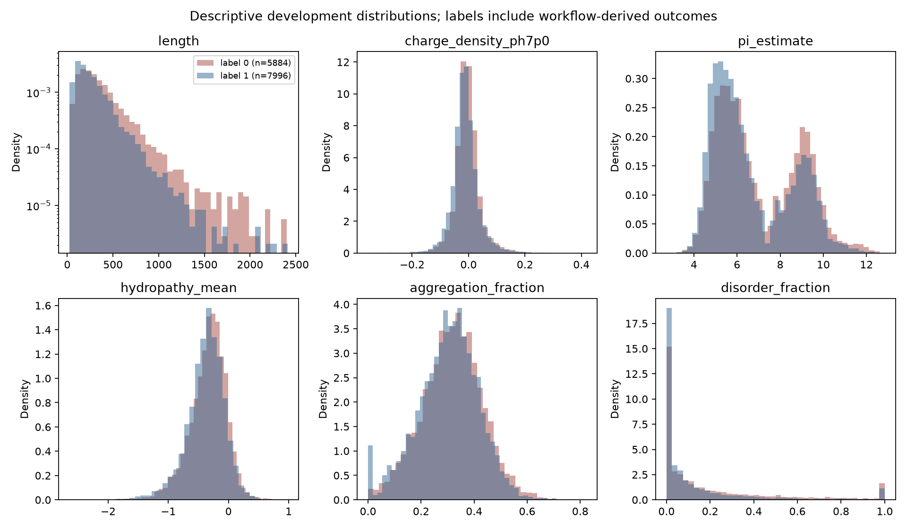
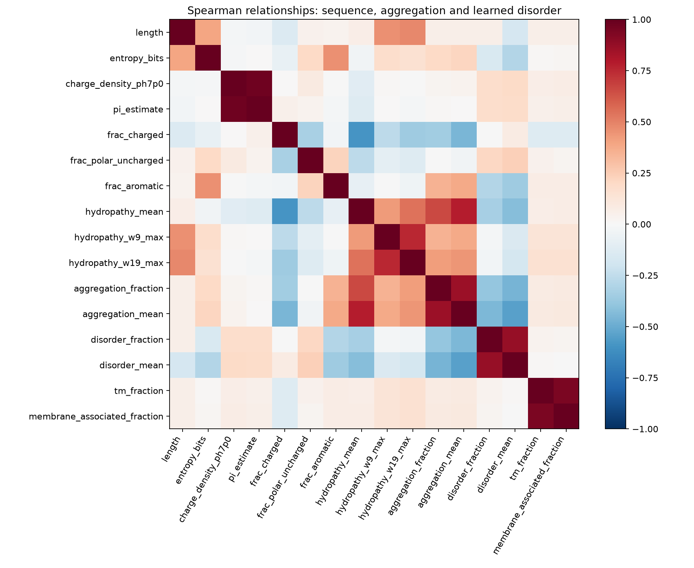
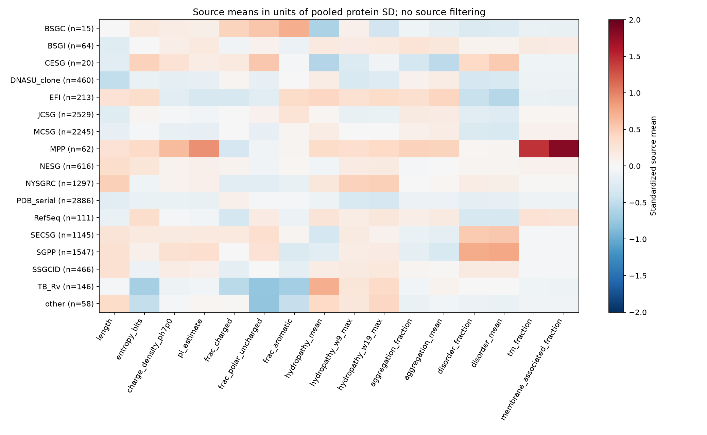
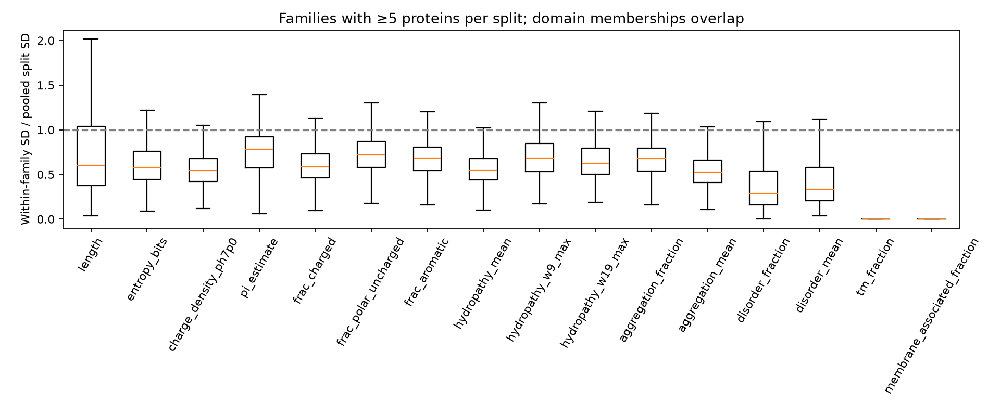

# UESolDS Phase 1: biological annotation and quality assessment

The annotation layer accounts for **all 13,880 proteins**, preserving the
heterogeneous A cohort, original labels/splits/sequences, stable IDs, hashes,
Pfam memberships and MMseqs2 groups. **The independent test was not opened.**
No solubility probe, SAE model, intervention or fine-tuning was performed.

**Current completion:** biochemical descriptors, the documented aggregation
reimplementation, learned disorder, reused Pfam/homology and uniform exact-sequence
taxonomy searches are complete. This is **not yet complete coverage of every
requested biological concept**: secondary structure, accessibility and SignalP
await the user's server outputs; the full TM job runs separately.

Uniform DeepTMHMM2 annotation is complete for 13,880 proteins.

## Cohort and QC

| split | label | n |
| --- | --- | --- |
| train | 0 | 3884 |
| train | 1 | 5996 |
| validation | 0 | 2000 |
| validation | 1 | 2000 |

The proteins contain **4,128,344 residues**; lengths range from
25 to 2413. **218 proteins**
extend beyond the first 1,022 residues visible to the existing ESM activations.
Full and visible summaries are separate. No tag stripping, relabelling, balancing,
family exclusion, sequence replacement or new split was applied.

[Validation checks](biological_annotation/validation_checks.json) verify all
13,880 positional records, unchanged input hashes,
19,347 retained Pfam domains with original scores,
and 152,801 interval coordinates. Scalar summaries
recomputed from saved positional data agree within 4.55e-12.
Detected homology groups remain disjoint across train/validation. Every sequence
is canonical in this frozen cohort; unknown/short-input handling is nevertheless
tested. No new biological value is filled from its solubility label.

## Annotation coverage and missingness

| concept | status | n |
| --- | --- | --- |
| accessibility | unavailable | 13880 |
| aggregation | ok | 13700 |
| aggregation | zero_features | 180 |
| biochemistry | ok | 13880 |
| disorder | ok | 8632 |
| disorder | zero_features | 5248 |
| homology | ok | 13880 |
| pfam | no_hit | 3413 |
| pfam | ok | 10467 |
| secondary_structure | unavailable | 13880 |
| signal_peptide | unavailable | 13880 |
| taxonomy | assigned_exact_species_consensus | 6386 |
| taxonomy | exact_match_ambiguous_taxonomy | 3018 |
| taxonomy | exact_match_engineered_taxon | 36 |
| taxonomy | no_exact_match | 4440 |
| transmembrane | ok | 456 |
| transmembrane | zero_features | 13424 |

`zero_features` is a successful prediction with no qualifying region; `no_hit`
is a successful Pfam search with no GA-passing domain. Taxonomic no-match,
ambiguous/engineered matches, pending computations and unavailable tools are
separate statuses. Missing numerical outputs remain `NA`, never zero.

Uniform Pfam coverage remains **10,467/13,880**.
Taxonomy uses UniProt **2026_04** snapshots: exact archived sequence equality is
required. Species consensus covers **6,386 proteins**;
there are **3,018 ambiguous matches**,
**36 engineered-taxon matches** and
**4,440 no-exact-match records**.
A reference match does not establish an unmodified native construct or validate
the solubility label. One returned archive taxon lacked a taxonomy ID; it remains
ambiguous. No source/host/name inference filled this or any other gap.

Coverage tables stratify by [source × label × split](biological_annotation/coverage_source_label_split.tsv),
[Pfam × label × split](biological_annotation/coverage_family.tsv),
[length](biological_annotation/coverage_length.tsv) and
[terminal-motif flags](biological_annotation/coverage_construct.tsv).
Biochemical/aggregation/disorder computations have no input-dependent failures in
this cohort. Taxonomic missingness is reference coverage/ambiguity, not absence of
organism identity. Pending server tools cannot yet be assessed for source-dependent
prediction failures.

## Overall distributions and relationships

| concept | mean | median | min | max |
| --- | --- | --- | --- | --- |
| full_length | 297.4 | 239 | 25 | 2413 |
| full_charge_density_ph7p0 | -0.008576 | -0.01034 | -0.3563 | 0.4173 |
| full_pi_estimate | 6.818 | 6.17 | 2.729 | 12.85 |
| full_hydropathy_mean | -0.362 | -0.3287 | -2.641 | 0.9857 |
| full_aggregation_fraction | 0.3091 | 0.3148 | 0 | 0.8228 |
| full_disorder_fraction | 0.1582 | 0.04505 | 0 | 1 |

Aggregation fraction is the fraction of residues in sequence-predicted APRs;
disorder fraction uses metapredict V3 scores ≥0.5. These are different constructs
and neither is an experimentally observed soluble fraction. Mean charge density
uses the stated pH and pKas, rather than the old KR−DE proxy.

Hydropathy and APR fraction have pooled Spearman correlation
**0.661**;
APR and disorder fractions have correlation
**-0.383**.
The aggregation scale shares hydrophobic/compositional information, so these
relationships are expected dependencies, not independent mechanistic validations.

## Source and family variation

Sources occupy different descriptive biological profiles. The following fractions
of observed protein-level variance lie between source means, calculated separately
by original split. These are descriptive associations, not causal decompositions:

| split | feature | between_source_fraction |
| --- | --- | --- |
| train | full_hydropathy_mean | 0.04709 |
| train | full_aggregation_fraction | 0.02311 |
| train | full_disorder_fraction | 0.1373 |
| validation | full_hydropathy_mean | 0.03746 |
| validation | full_aggregation_fraction | 0.02907 |
| validation | full_disorder_fraction | 0.1068 |

For family variation, 673 Pfam × split strata contain ≥5 proteins.
Their per-feature within-family SD relative to the pooled split SD has the
following median across strata:

| feature | within_sd_over_global_sd |
| --- | --- |
| full_aggregation_fraction | 0.6771 |
| full_aggregation_mean | 0.5266 |
| full_charge_density_ph7p0 | 0.5447 |
| full_disorder_fraction | 0.2885 |
| full_disorder_mean | 0.3344 |
| full_entropy_bits | 0.5764 |
| full_frac_aromatic | 0.6857 |
| full_frac_charged | 0.5861 |
| full_frac_polar_uncharged | 0.7177 |
| full_hydropathy_mean | 0.5512 |
| full_hydropathy_w19_max | 0.6233 |
| full_hydropathy_w9_max | 0.6803 |
| full_length | 0.6022 |
| full_membrane_associated_fraction | 0 |
| full_pi_estimate | 0.7833 |
| full_tm_fraction | 0 |

Thus family identity often narrows biochemical variation while leaving variation
for later conditional analysis. This is not a power calculation. A shared Pfam
domain does not hold the complete architecture, organism or experimental workflow
constant. Domain memberships overlap and repeated appearances are not independent
proteins. [Family support](biological_annotation/family_biochemical_support.tsv)
retains group/source counts and single-class families. Primary A is unchanged.

## Descriptive label associations

All prespecified descriptors and amino-acid fractions are retained irrespective
of association size. Separate tables give [pooled](biological_annotation/label_associations_pooled.tsv),
[within-source](biological_annotation/label_associations_source.tsv),
[within-family](biological_annotation/label_associations_family.tsv), and
[within-family/source](biological_annotation/label_associations_family_source.tsv)
contrasts, with ≥3 observations per label in each reported stratum and homology
group counts. These tables contain means and standardized differences, **not AUROC**.

For example, the label-1 minus label-0 disorder association varies by centre/split:

| split | center | n0 | n1 | standardized_difference |
| --- | --- | --- | --- | --- |
| train | JCSG | 832 | 807 | 0.0822489482697 |
| train | MCSG | 561 | 1157 | 0.054991650141 |
| train | SGPP | 743 | 349 | -0.144923536393 |
| validation | JCSG | 269 | 621 | 0.36502497437 |
| validation | MCSG | 367 | 160 | -0.0304663807386 |
| validation | SGPP | 361 | 94 | 0.109864500571 |

There are 90 supported family/source/split
strata for these descriptive contrasts. This does not mean that all have matching
support in both splits; consult the earlier [family × source report](FAMILY_SOURCE_REPORT.md)
for controlled B feasibility. The previous 69-family focus is not a replacement
training cohort. Neither these associations nor the earlier provenance-sensitive
AUROCs establish direct versus indirect ESM encoding.

## Aggregation discrepancy and remaining limitations

The independent AGGRESCAN implementation reproduces the published SH3 example's
interior scores, APR counts and normalized means. The example's terminal values
use the reverse of the paper's stated terminal convention. We preserve the written
rule as primary and explicitly report the reversed-rule sensitivity.
**1,110 proteins** change
at least one APR boundary under that sensitivity. The mean absolute APR-fraction
change is **0.00178**;
the maximum is **0.1389**.
This unresolved implementation ambiguity warrants exploratory use, particularly
for terminal localisation. **11 sequences**
exceed the old server's 2,000-residue limit and carry a separate extrapolation flag.

Metapredict is a validated accessible alternative, **not IUPred3**; its AlphaFold-
derived training targets introduce model dependence. DeepTMHMM2 and NetSurfP
depend directly on pretrained protein representations. Agreement with ESM features
will therefore not constitute independent experimental corroboration. Charge/pI
ignore folded microenvironments and modifications. Existing construct/tag flags
are observations, not confirmed engineering or truncation annotations. Pfam clan
competition is retained; candidate architectures may contain overlapping alternatives.
UESolDS label-provenance limitations remain unchanged.

## Readiness and next action

- **Ready as reproducible sequence concepts:** length, composition, charge estimates,
  pI and hydropathy, using ESM-visible summaries when relating to cached activations.
- **Ready with explicit annotation uncertainty:** Pfam memberships/architectures and
  homology groups. Preserve overlap/no-hit indicators and the prior controlled subsets.
- **Exploratory:** aggregation (including terminal sensitivity), learned disorder,
  exact archive species-consensus taxonomy and model-derived TM predictions once complete.
  They must not be described as experimental biology.
- **Pending:** NetSurfP structure/accessibility and SignalP results; no placeholder
  values or generic hydrophobicity substitutions are supplied. Primary A keeps all
  records while these annotations are missing.

Continue using heterogeneous all-source A with source-stratified and within-family
analyses. Annotation does not solve uncertain experimental labels or the sparse,
overlap-sensitive same-source B support established earlier. Do not select a cohort
or explanatory feature set based on solubility prediction performance.

The server packet is at `/tmp/uesolds-server-upload.zip`. It contains
20 NetSurfP batches covering all 13,880 records; SignalP-ready batches cover
3,014 Eukarya and 3,182 Bacteria/Archaea records, with 7,684 unresolved settings
retained separately. Follow its README and retain raw positional outputs/job metadata.
Full sequences and neutral upload IDs have reproducible hash mappings. Files are
outside the checkout to avoid temporary FASTAs following branch switches.

## Files

- [Methods, dependencies and reproduction](BIOLOGICAL_ANNOTATION_METHODS.md)
- [Unified protein table](biological_annotation/protein_annotations.tsv)
- [Column dictionary](biological_annotation/feature_dictionary.tsv)
- [Per-record annotation status](biological_annotation/annotation_status.tsv)
- [Regional coordinates](biological_annotation/regions.tsv) and [Pfam domains](biological_annotation/pfam_domains.tsv)
- `aggregation_profiles.npz`, `sequence_profiles.npz`, `disorder_shards/`: full positional data
- `taxonomy_responses/`, `taxonomy.tsv`: exact-match reference evidence
- `transmembrane_pilot_results/`, `transmembrane_shards/`: raw predictor evidence
- [Input hashes](biological_annotation/input_hashes.json), [QC](biological_annotation/validation_checks.json), [output hashes](biological_annotation/output_hashes.json)
