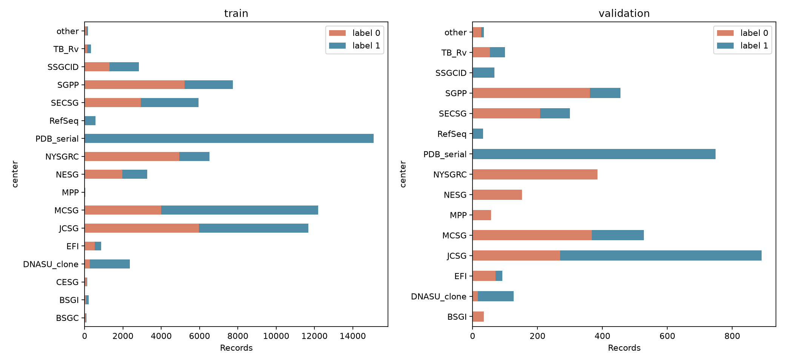
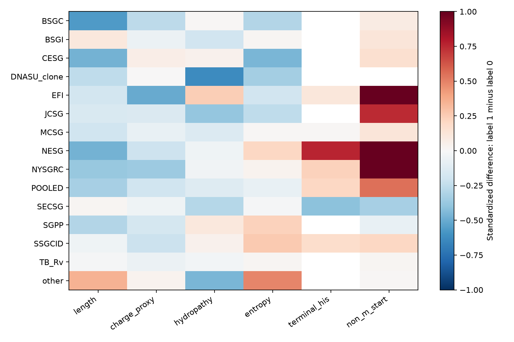
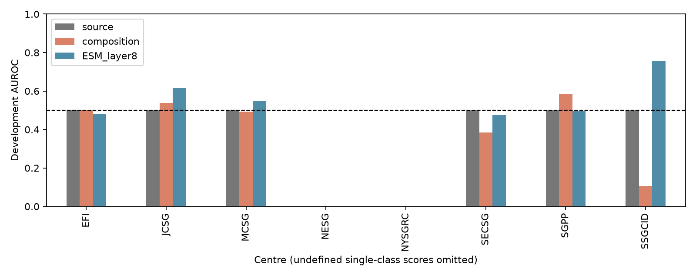

# UESolDS validity audit — 2026-11-08

The defensible next step is **exploratory probing on a source-controlled, homology-filtered development cohort**, with within-centre reporting. It is not yet a verified solubility benchmark. Strict-label analysis is unavailable because record-level experimental outcomes have not been recovered. Do not interpret near-chance probes as evidence that ESM lacks biochemical solubility information, or a higher pooled score as evidence that cleaning succeeded.

## Existing work and gaps

The submitted proposal distinguishes biochemical composition, regional features and biological identity from property representations. Its planned MMseqs2 control was still missing. Existing code already established source-only confounding, sampled a reproducible 10,000-training/4,000-validation cohort, computed composition probes and frozen ESM-2 layer-8 embeddings, and attempted organism/Pfam annotation on 100 training proteins. Those artifacts are reused. No ESM extraction, fine-tuning, annotation API batch or SAE training was repeated.

The prior five-centre evaluation selected centres with at least 20 examples per validation class. The new rule uses **training support only** and selects eight centres: EFI, JCSG, MCSG, NESG, NYSGRC, SECSG, SGPP, SSGCID. Small validation strata remain visible; some AUROCs may be undefined. This changes the estimand, so the eight-centre macro should not be presented as a direct replacement for the historical five-centre number without naming its denominator.

The release was acquired previously as PLM_Sol V1.1 (vendored tree `3589a95`; [Zenodo release](https://zenodo.org/records/12881509)). The original acquisition transaction is not independently reconstructed here. Input SHA-256 hashes now freeze the exact local bytes used. Published train/validation contain 70,031/4,000 records. The existing exclusion of one training record previously found in test is retained without rereading test. Historical test inspection is documented in FINDINGS; this audit does not imply that test was never inspected in the project's history.

## Label provenance: source-level evidence versus row-level verification

The [original PLM_Sol methods](https://academic.oup.com/bib/article/25/5/bbae404/7739950) describe the following construction:

| Source | Published label assignment | Interpretation for this audit |
|---|---|---|
| TargetTrack | Early selection/cloning/expression-testing stages become negatives; expression/solubility/purification/structure stages become positives | Workflow progress is not a direct negative solubility measurement; expression alone does not establish soluble yield. |
| DNASU | Explicit soluble/not-soluble status fields | Stronger candidate evidence, but no construct-matched status export is included locally. |
| eSOL | Presence versus absence of a solubility score determines class | Missingness must not be treated as experimental insolubility. No accession-to-measurement mapping is recovered here. |
| PDB | E. coli expression-host sequences become positives | Structure-associated selection, not a uniform soluble-expression assay. |

The paper also reports membrane, tag, character and length filtering, asymmetric removal of negative sequences similar to positives, and MMseqs2 redundancy reduction. These are published construction claims, not reproduced upstream processing. Such filtering can change class composition. Our audit evaluates the released sequences independently.

The [eSOL archive](https://dbarchive.biosciencedbc.jp/en/esol/desc.html) describes cell-free measurements and chaperone-dependent conditions; these are different from cellular recombinant expression. The [DNASU materials-repository paper](https://pmc.ncbi.nlm.nih.gov/articles/PMC3184641/) documents experimental status fields. These sources support recovering original measurements, not guessing them from a FASTA identifier. A RefSeq prefix is **not** a reliable eSOL assignment, and a DNASU-like clone prefix is **not** a verified assay result.

No raw TargetTrack status history, DNASU assay table or eSOL score table accompanies the local release. Pilot UniProt/Pfam matches establish biological annotation, not expression outcome. Accordingly every strict-label eligibility decision is false with an explicit reason; no labels are guessed or flipped. A future strict cohort requires exact construct/sequence linkage, original outcome, assay context and evidence URL, including experimentally established negatives. Positive-only structural records would not make a valid binary cohort.

## Verified development EDA

Source-label association is severe. Full training PDB_serial (15,085) and RefSeq (567) contain only positives; the historical eligible PDB count is 15,084 after its exclusion. MCSG has 8,201 positive/3,997 negative examples, whereas NYSGRC has 1,567/4,944. The whole-source distribution differs from validation, which was published with balanced labels. We preserve that distribution rather than rebalance it again. Header classes remain provenance proxies, not definitive original-database assignments.

Across all training records, standardized positive-minus-negative differences are −0.333 for length, −0.202 for charge proxy, and −0.125 for mean Kyte–Doolittle hydropathy. Within centres the hydropathy association changes sign: JCSG −0.390, EFI +0.247, SGPP +0.103. Length also changes direction (SECSG +0.021 versus NESG −0.472). These descriptive associations are not a universal solubility law. All 20 amino-acid fractions, entropy and within-source contrasts are in `descriptor_summary.tsv` and `within_source_effects.tsv`; no significance-based feature selection was performed. Charge is `(K+R−D−E)/length`, not a pH-specific net-charge calculation. Entropy is a composition descriptor, not a disorder predictor.

| Flag | Train label 0 | Train label 1 | Validation label 0 | Validation label 1 |
|---|---:|---:|---:|---:|
| Terminal His run | 702 (2.55%) | 2,928 (6.90%) | 9 (0.45%) | 100 (5.00%) |
| Terminal cleavage motif | 79 (0.29%) | 1,696 (4.00%) | 3 (0.15%) | 113 (5.65%) |
| GS-rich terminal run | 40 (0.15%) | 110 (0.26%) | 2 (0.10%) | 10 (0.50%) |
| Does not start with M | 5,181 (18.78%) | 18,330 (43.18%) | 403 (20.15%) | 971 (48.55%) |
| Longer than ESM's 1,022-residue input | 685 (2.48%) | 391 (0.92%) | 48 (2.40%) | 13 (0.65%) |

Motifs are verified sequence observations; their interpretation as artificial tags/linkers or causal shortcuts is suspected. Non-M starts do not prove truncation. Length variation among repeated identifiers is consistent with alternative constructs but needs reference alignments for confirmation. No automatic tag stripping or fragment exclusion is applied. Invalid syntax/empty sequences: zero. Two training records contain B and are flagged as ambiguous; cleaned cohorts exclude these two without changing their originals.

Only 100/70,031 training records have attempted annotations, and none of validation do. Among attempts, 69 have confident organism assignments, three are ambiguous across organisms, and 28 have no exact match; 49 have Pfam assignments. The pilot has 39 negatives/61 positives; Pfam coverage is 20/39 versus 29/61. Neither unqueried records nor failed matches establish biological absence. `annotation_attempted_only.tsv` stratifies this limited pilot by source and label; most strata are too small for population conclusions. In particular, the earlier assertion that all 28 unmatched records are tagged/truncated goes beyond the available evidence. No-match can also reflect database coverage or other construct differences.

## Preprocessing rationale and limits

See [README](README.md) for exact commands, descriptor definitions and rules. Original records and all earlier results are preserved. Every cleaned row links back to its original split, FASTA position, identifier, hash and legacy cache key. The old builder assigns indices **after** excluding a training row, contrary to its documented original-position interpretation; the new mapping makes the distinction explicit. In this release the excluded row is last, and all 14,000 cached keys already agree with raw positions (zero displaced indices). No cache corruption was found.

The original comparison retains the existing 70,030-row eligible training pool and all validation. `clean_all_sources` isolates sequence/homology cleaning from source restriction. `source_controlled` additionally selects adequately supported SG centres. Its pooled score may still exploit between-centre prevalence differences; within-centre scores are primary. This restriction sacrifices source coverage and does not resolve differences in protocols or target selection within a centre. DNASU_clone has both classes but identifies a repository, not a structural-genomics centre in this header scheme; it remains in the all-source diagnostic cohort and is a priority for verified-outcome recovery. Its omission from the centre-controlled cohort is a scope choice, not a judgment that its labels are less trustworthy.

Homology is measured using direct validation-to-training MMseqs2 search and all-development clustering: 30% identity, 80% bilateral coverage, E <=0.001, sensitivity 7.5. Training neighbours and validation-containing clusters are excluded, along with shared identifiers. This preserves evaluation sequences but reduces training diversity and makes retained training intentionally more distant. It does not guarantee independence below the threshold, for shared domains, or among homologues MMseqs2 misses. The [MMseqs2 documentation](https://github.com/soedinglab/MMseqs2) explains the approximate search and configurable alignment thresholds. The current binary's new Linclust implementation rejects connected-component mode; the pipeline explicitly selects Linclust version 1, retaining the intended cluster criterion.

No independent test data influenced the thresholds, source list, plots or probes. Final test homology auditing and one-time evaluation remain future work. Because development outcomes were already known from earlier experiments, these results are exploratory; fixed new rules avoid further score-driven optimization but cannot restore pristine validation status.

## Measured before/after comparison

The audit found 0 exact-duplicate records and 0 records with identical-sequence label conflicts across train/development. There are 376 records with reused identifiers. MMseqs2 found 668 cross-split pairs involving 660 training and 624 validation records. All development records occupy 67229 detected clusters. The cache mapping detects 0 displaced legacy indices.

Full-pool cohort composition (cluster counts refer to the same all-development clustering):

| cohort | split | n | insoluble | soluble | unique_sequences | clusters | centers |
| --- | --- | --- | --- | --- | --- | --- | --- |
| original | train | 70030 | 27581 | 42449 | 70030 | 63897 | 17 |
| original | validation | 4000 | 2000 | 2000 | 4000 | 3978 | 15 |
| clean_all_sources | train | 69248 | 27266 | 41982 | 69248 | 63229 | 17 |
| clean_all_sources | validation | 4000 | 2000 | 2000 | 4000 | 3978 | 15 |
| source_controlled | train | 50436 | 26568 | 23868 | 50436 | 46487 | 8 |
| source_controlled | validation | 2867 | 1813 | 1054 | 2867 | 2857 | 8 |
| strict_label | train | 0 | 0 | 0 | 0 | 0 | 0 |
| strict_label | validation | 0 | 0 | 0 | 0 | 0 | 0 |

Matched cached-embedding comparison sizes:

| cohort | split | n | insoluble | soluble |
| --- | --- | --- | --- | --- |
| original | train | 10000 | 3937 | 6063 |
| original | validation | 4000 | 2000 | 2000 |
| clean_all_sources | train | 9880 | 3884 | 5996 |
| clean_all_sources | validation | 4000 | 2000 | 2000 |
| source_controlled | train | 7191 | 3788 | 3403 |
| source_controlled | validation | 2867 | 1813 | 1054 |
| strict_label | train | 0 | 0 | 0 |
| strict_label | validation | 0 | 0 | 0 |

All three models are refit per cohort on exactly those cached training rows, with training-only preprocessing. No ESM weights are loaded or updated. The original row below is the previously frozen 10,000-training comparison, not a new full-70,030-training ESM experiment.

| cohort | group | ESM_layer8 | composition | source |
| --- | --- | --- | --- | --- |
| clean_all_sources | MACRO_training_selected_centers | 0.5316 | 0.4349 | 0.5000 |
| clean_all_sources | POOLED | 0.6769 | 0.6565 | 0.7791 |
| original | MACRO_training_selected_centers | 0.5296 | 0.4359 | 0.5000 |
| original | POOLED | 0.6759 | 0.6563 | 0.7792 |
| source_controlled | MACRO_training_selected_centers | 0.5623 | 0.4343 | 0.5000 |
| source_controlled | POOLED | 0.6169 | 0.6231 | 0.6456 |

Per-centre source-controlled validation results (single-class AUROC is undefined):

| group | n0 | n1 | ESM_layer8 | composition | source |
| --- | --- | --- | --- | --- | --- |
| EFI | 71 | 21 | 0.4789 | 0.5010 | 0.5000 |
| JCSG | 269 | 621 | 0.6162 | 0.5375 | 0.5000 |
| MCSG | 367 | 160 | 0.5495 | 0.4926 | 0.5000 |
| NESG | 152 | 0 | undefined | undefined | undefined |
| NYSGRC | 384 | 0 | undefined | undefined | undefined |
| SECSG | 208 | 92 | 0.4744 | 0.3848 | 0.5000 |
| SGPP | 361 | 94 | 0.4970 | 0.5839 | 0.5000 |
| SSGCID | 1 | 66 | 0.7576 | 0.1061 | 0.5000 |

The reported training-selected macro averages **six defined centres out of eight**. NESG and NYSGRC have no positive validation records; SSGCID has only one negative. Its large score contribution makes the six-centre macro unstable; use the historical five-centre sensitivity and per-centre counts to interpret it. The TSV reports every source for every cohort, along with AP and sample sizes. The macro averages only centres with both validation labels. Small strata have high uncertainty; no significance claim or cohort selection is based on these scores. Different pooled populations are not paired comparisons.

Historical five-centre macro for continuity (same named centres, refit training per cohort):

| cohort | ESM_layer8 | composition | source |
| --- | --- | --- | --- |
| clean_all_sources | 0.5228 | 0.4977 | 0.5000 |
| original | 0.5173 | 0.4989 | 0.5000 |
| source_controlled | 0.5232 | 0.5000 | 0.5000 |

The original ESM five-centre mean reproduces to about 0.0001 across the old and new software environments (0.5174 historically versus 0.5173 here); environment versions are recorded. This numerical difference is not a biological change.

## Recommendation and remaining work

Use the **cached source-controlled cohort after homology filtering** for a bounded exploratory SAE comparison, retaining the original and cleaned-all-source results as diagnostics. This choice follows provenance support and leakage controls, not whichever AUROC is largest. Use the exact `raw_uid`/`legacy_uid` mapping and unchanged sequences to reuse ESM representations. Report each centre, its class counts, and the macro denominator; preserve the historical five-centre score as a secondary continuity measure.

Do **not** label this cohort experimentally verified or use it alone to claim direct solubility representations. Source control reduces a measured shortcut and train/development homology filtering addresses detectable leakage, but neither repairs workflow-derived labels. Strict-label comparison is explicitly unavailable (zero verified rows, no model fit). Recover construct-matched DNASU statuses or original quantitative eSOL measurements before making stronger solubility claims. Lack of matches or scores must remain unknown. This is the main scientific blocker, not insufficient probe AUROC.

The six-week scope supports one frozen cohort, one layer and paired concept/property analyses with these limitations. Avoid a large annotation/relabeling project or a model/threshold sweep. Family and organism controls remain limited by pilot coverage, and repeated constructs and assay heterogeneity remain possible biases. Future uncertainty estimates should resample homology clusters within centres; the reported point estimates alone do not establish an ESM advantage. Earlier statements that homology would inflate every model equally are not justified: different feature sets may exploit relatives differently.

Validation checks passed for original input preservation, sequence/hash cache alignment, finite model inputs, optimizer convergence and cleaned split separation by exact sequence, shared identifier, detected cross-split hit and cluster. No independent test file was opened. Generated inputs are reproducible and ignored by Git; manifests, compact evidence tables, plots and run provenance are retained.
