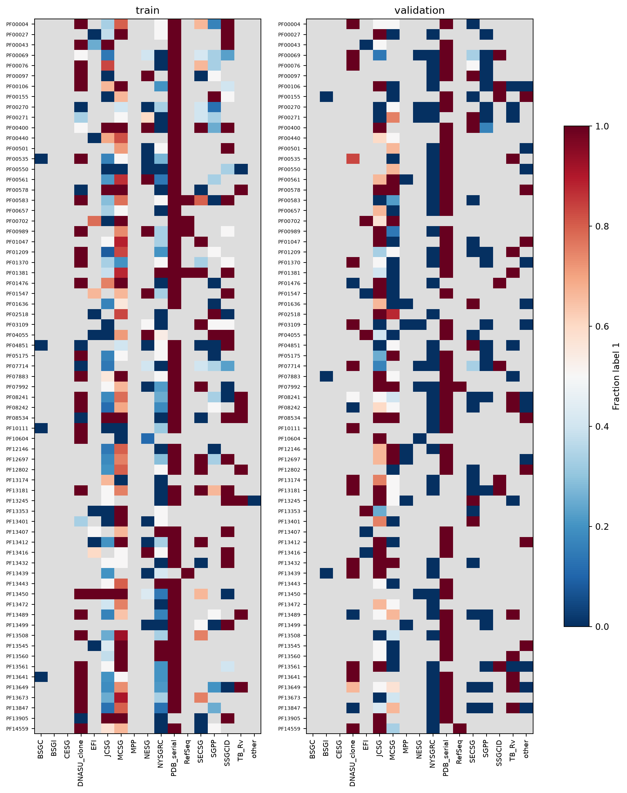

# Family × source × solubility: focused development analysis

## Recommendation

**Retain all-source heterogeneous A and use several centres with source-stratified evaluation and controlled subsets. Do not replace A with JCSG, MCSG, or mixed-label families alone.** The uniform-Pfam cohort remains 9,880 training + 4,000 validation proteins, with all naturally observed family–label associations, single-class families and no-hit proteins retained. The recommendation is based on biological coverage, unresolved label provenance and within-source sample support, not ranking probe AUROCs.

JCSG and MCSG are useful complementary source strata. Neither has demonstrated better label reliability. JCSG offers more validation proteins and a larger minority class, while MCSG contributes distinct training family coverage and a differently selected population. Neither currently supports a robust ambiguity-filtered within-family validation design at ≥3/class. Do not prioritize one as a supposedly clean solubility benchmark.

Do **not** begin a large new embedding extraction to solve the B support problem. The larger training pool adds substantial diversity, but unchanged validation places a strict ceiling on useful family × source contrasts. Additional training annotations cannot repair absent validation support or workflow-derived labels. Keep the current models and embeddings available for exploratory concept/property comparisons while explicitly retaining these limitations.

## Scope and definitions

The 69 focus families are the previously reported GA-passing Pfam accessions with ≥3 label-0 and ≥3 label-1 proteins in both original splits. This focus was selected using development labels and is therefore a **descriptive development analysis**, not a pristine held-out estimate. All metadata probes train on heterogeneous A, not on these 69 families. No independent test, raw sequence file or embedding was read in this extension; original artifacts are only read and hashed.

A Pfam family denotes a domain-model assignment, not necessarily the whole protein. Multidomain proteins appear in several family tables. `raw_uid` is deduplicated for union counts; Pfam memberships are never equated with MMseqs2 groups or clans. No family distributions or labels are balanced, removed to erase correlation, or residualized.

## Family × source counts and variation

The focus contains **1,139 distinct training and 609 validation proteins**. The complete [count table](family_source_results/focus_69_family_source_counts.tsv) explicitly enumerates all 69 families × 17 source proxies × two splits, including zero-record cells. Each cell reports both labels, prevalence, distinct groups per label, shared-label groups and class-exclusive groups. [Family totals](family_source_results/focus_69_family_counts.tsv) and [variation summaries](family_source_results/focus_69_variation.tsv) accompany it.

- In training, 3/69 families have both labels only across sources, with no source containing both labels. In validation, that number rises to **24/69**.
- Thirty-two families have at least one training source with ≥3/class, and seven have such a validation source. Requiring the **same family/source pair in both splits** leaves only four pairs, representing three related Pfam models.
- Thus a mixed-label family is not automatically a within-family/within-source contrast. A model can rank its labels by source even when family membership is held constant.



Blue/red denote label-1 prevalence from zero to one; gray means no observed records. Cell sample sizes are in the linked table. A saturated cell can represent one observation; the heatmap alone is not evidence of a deterministic population relationship.

To distinguish the levels quantitatively, the following descriptive variance partitions use each focus protein with total weight one, divided across its memberships in these 69 families. For binary labels, total variance is p(1−p). Applying the law of total variance first by family, then source, gives:

| split | proteins | between family (%) | between source within family (%) | within family and source (%) |
| --- | --- | --- | --- | --- |
| train | 1139 | 10.4 | 39.6 | 50 |
| validation | 609 | 16.15 | 64.08 | 19.77 |

Reversing the conditioning order gives:

| split | between source (%) | between family within source (%) | within both (%) |
| --- | --- | --- | --- |
| train | 27.33 | 22.67 | 50 |
| validation | 48.13 | 32.1 | 19.77 |

The shared family/source association cannot be assigned uniquely to one cause, so ordering changes the first two components. These are finite-sample descriptive partitions on the **selected 69-family focus**, not causal effects, biological variance estimates, or a reason to remove family associations. Sparse cells can inflate apparent between-cell separation. No outcome-based correction is applied to A.

## Metadata baselines and grouped evaluation

Three fixed-C=1 L2 logistic regressions use the same 9,880/4,000 split, no class weighting, no tuning and seed 42:

- **Family:** multi-hot Pfam memberships plus an explicit no-usable-Pfam indicator. This captures observed family identity and annotation availability, not only biological family effects.
- **Source:** one-hot ID class and centre, reusing the earlier source-proxy definition.
- **Family + source:** additive concatenation; no interaction or sequence features.

Encoders and family vocabulary are fit on training only. Validation-only Pfam accessions are ignored as unseen features and counted in `baseline_fits.tsv`; they are not relabelled as biologically absent. All training labels and natural family associations are retained. Every detected MMseqs2 group is disjoint across the existing training/validation split, including in the full cleaned pool. This fixed group-separated split is the main evaluation; no random record-level cross-validation is introduced.

Pooled AUROC with approximate 95% percentile intervals from 200 resamples of **validation homology groups** (all members resampled together; conditional on the fitted models):

| model | auroc | low | high |
| --- | --- | --- | --- |
| family | 0.5556 | 0.5391 | 0.5713 |
| source | 0.7791 | 0.7664 | 0.7915 |
| family_plus_source | 0.7747 | 0.762 | 0.7856 |

Grouped validation AUROCs for the same predictions:

| group_type | group | n | family | family_plus_source | source |
| --- | --- | --- | --- | --- | --- |
| focus_union | 69_families | 609 | 0.4824 | 0.7705 | 0.8299 |
| macro | exact_family_set_source_val_ge3 | 7 | 0.5 | 0.5 | 0.5 |
| macro | family_source_train_ge3_val_ge3 | 4 | 0.3655 | 0.3707 | 0.5 |
| macro | focus_family_val_ge3 | 69 | 0.4922 | 0.7565 | 0.7761 |
| source | JCSG | 890 | 0.5401 | 0.5263 | 0.5 |
| source | MCSG | 527 | 0.4779 | 0.4614 | 0.5 |

For macro rows, `n` is the number of strata, not proteins. Macro means give each defined stratum equal weight and require ≥3 validation proteins per class. The family/source macro additionally requires ≥3/class in that training cell. Every individual family and source score, AP, Brier score and log loss is saved in `baseline_group_results.tsv`; predictions and fit diagnostics are also retained. Probabilities are saved with 17 significant digits to preserve tied-score ranks; the integration test reloads them with round-trip float parsing and reproduces pooled AUROCs. Single-class AUROC remains undefined.

**The important observation is source-only AUROC 0.776 averaged within the 69 families.** Family conditioning alone leaves a strong provenance-associated signal. Within a single centre, source features are constant and source-only AUROC is exactly 0.5. Within-family family-only performance near chance is partly expected because the shared family feature is held constant. It does not establish the absence of meaningful family–solubility associations: domain granularity, shifted source mixtures, sparse training support and label noise all remain plausible limitations.

A multi-hot family model can vary **within one shared Pfam** because proteins carry other Pfams. It should not be expected to score exactly 0.5 within a single family. Holding the **entire observed Pfam set and source** fixed makes all three primary metadata models constant; their macro AUROC is 0.5, as checked. This is a diagnostic of model inputs, not evidence that true solubility is absent. Multidomain overlap makes family-stratum scores dependent; no significance claim is made from the four tiny, related source-matched strata or from their low AUROCs.

The no-clan-competition sensitivity changes only usable family features, never A membership or the fixed evaluation strata:

| model | group | n | auroc | AP |
| --- | --- | --- | --- | --- |
| family | ALL | 4000 | 0.5684 | 0.5477 |
| family | focus_family_val_ge3 | 69 | 0.5414 | 0.5003 |
| source | ALL | 4000 | 0.7791 | 0.8037 |
| source | focus_family_val_ge3 | 69 | 0.7761 | 0.795 |
| family_plus_source | ALL | 4000 | 0.7868 | 0.8171 |
| family_plus_source | focus_family_val_ge3 | 69 | 0.7659 | 0.7958 |

A source-transfer sensitivity excludes all JCSG or all MCSG training records, fits the same models on the remaining heterogeneous training set, and evaluates only that centre's original validation records. No validation record enters fitting:

| protocol | model | n | auroc | AP |
| --- | --- | --- | --- | --- |
| leave_JCSG_out | family | 890 | 0.5018 | 0.6979 |
| leave_JCSG_out | source | 890 | 0.5 | 0.6978 |
| leave_JCSG_out | family_plus_source | 890 | 0.4785 | 0.6902 |
| leave_MCSG_out | family | 527 | 0.4908 | 0.3035 |
| leave_MCSG_out | source | 527 | 0.5 | 0.3036 |
| leave_MCSG_out | family_plus_source | 527 | 0.4736 | 0.3042 |

These diagnostics measure metadata association under source shifts; they do not select a preferred centre or establish causal solubility encoding. The original development set has been inspected repeatedly. The independent test remains locked.

## JCSG versus MCSG

Counts and Pfam coverage use the complete cached A records from each centre:

| center | split | n | n0 | n1 | prevalence | coverage | groups0 | groups1 | families | mixed_families | families_ge3 | families_ge5 |
| --- | --- | --- | --- | --- | --- | --- | --- | --- | --- | --- | --- | --- |
| JCSG | train | 1639 | 832 | 807 | 0.4924 | 0.7498 | 832 | 807 | 1116 | 200 | 27 | 7 |
| JCSG | validation | 890 | 269 | 621 | 0.6978 | 0.6764 | 267 | 620 | 711 | 60 | 5 | 2 |
| MCSG | train | 1718 | 561 | 1157 | 0.6735 | 0.7625 | 560 | 1157 | 1156 | 185 | 18 | 8 |
| MCSG | validation | 527 | 367 | 160 | 0.3036 | 0.7116 | 366 | 160 | 453 | 40 | 3 | 0 |

JCSG has 49.2% label 1 in training but 69.8% in validation; MCSG has 67.3% versus 30.4%. These opposing prevalence shifts are verified dataset observations, not evidence that either centre's biology changed. The full cleaned training pools retain similar class proportions, so simply adding more training records does not fix the shift.

JCSG offers 890 validation proteins, including 269 label 0; MCSG offers 527, including 160 label 1. Training Pfam coverage is approximately 75.0% and 76.3%, respectively, but validation coverage falls to 67.6% and 71.2%. Training Pfam sets share 322 accessions: 794 are observed in JCSG but not MCSG training, and 834 in MCSG but not JCSG training. These are observed differences within the cached samples, not claims of biological absence from the centres. Coverage is complementary and incomplete; domain counts do not establish organism or assay diversity.

The stronger same-family support requiring ≥3 or ≥5 per class independently in both splits is:

| center | policy | k | current_both_splits | validation_only_ceiling |
| --- | --- | --- | --- | --- |
| JCSG | GA_all | 3 | 3 | 5 |
| JCSG | GA_all | 5 | 0 | 2 |
| JCSG | no_clan_competition | 3 | 0 | 0 |
| JCSG | no_clan_competition | 5 | 0 | 0 |
| MCSG | GA_all | 3 | 1 | 3 |
| MCSG | GA_all | 5 | 0 | 0 |
| MCSG | no_clan_competition | 3 | 0 | 0 |
| MCSG | no_clan_competition | 5 | 0 | 0 |

With GA assignments, JCSG supplies three qualifying family/source pairs at ≥3 and MCSG one. They involve the related methyltransferase profiles PF08241/PF13489/PF13649 in CL0063. Neither centre has a ≥5 pair. Removing competing overlapping clan assignments leaves **zero ≥3 validation families in both centres**, even before asking whether training support is sufficient. Narrowing the project to one centre would sacrifice heterogeneity without resolving this controlled-evaluation bottleneck.

**Label reliability: no defensible winner.** The [PLM_Sol methods](https://academic.oup.com/bib/article/25/5/bbae404/7739950) derive TargetTrack labels from workflow statuses, including early stages for negative labels. The [original TargetTrack archive](https://zenodo.org/records/821654) contains status/protocol records, but the current curated release has no recovered construct-matched outcome or protocol table for these JCSG/MCSG records. Centre equality is a proxy, not proof of matched conditions. No record-level verified-outcome counts improve by choosing either centre. We did not download the archive, infer missing outcomes, or rank reliability from AUROC, Pfam coverage or centre name.

## Could the larger training pool help?

Directly observed counts, preserving the existing cleaning and homology exclusions:

| center | scope | n | n0 | n1 | groups | groups_not_in_cached_center | uniform_Pfam_annotated |
| --- | --- | --- | --- | --- | --- | --- | --- |
| ALL | cached | 9880 | 3884 | 5996 | 9738 | 0 | 9880 |
| ALL | additional | 59368 | 23382 | 35986 | 54871 | 53491 | 0 |
| ALL | full | 69248 | 27266 | 41982 | 63229 | 53491 | 9880 |
| JCSG | cached | 1639 | 832 | 807 | 1633 | 0 | 1639 |
| JCSG | additional | 9881 | 5026 | 4855 | 9459 | 9339 | 0 |
| JCSG | full | 11520 | 5858 | 5662 | 10972 | 9339 | 1639 |
| MCSG | cached | 1718 | 561 | 1157 | 1707 | 0 | 1718 |
| MCSG | additional | 10355 | 3397 | 6958 | 9891 | 9733 | 0 |
| MCSG | full | 12073 | 3958 | 8115 | 11440 | 9733 | 1718 |

The additional **59,368 training proteins** include **53,491 groups not represented in cached training**. This is substantial potential biological diversity. JCSG adds 9,881 proteins; MCSG adds 10,355. However, their **uniform Pfam assignments are unknown**, so they cannot be counted as confirmed members of any family. No 6× or 7× extrapolation of family counts is justified.

A conservative evidence-only check links unannotated records to clusters already containing an annotated cached training member of a focus family. It identifies **283 candidate proteins in 220 already represented groups**, linked to 65 of the focus families; JCSG contributes 40 candidates and MCSG 51. These are follow-up clues, not transferred Pfam annotations, and they add **zero new global independent groups by construction**. Their mappings and caveat are saved in `unannotated_cluster_link_candidates.tsv`. We do not use these candidates to fit a model or selectively expand A.

The validation-only ceiling is rigorous for the current annotation policy and unchanged validation set: no amount of additional training support can create a qualifying family that lacks the required validation labels. It is an optimistic bound, **not a prediction** that the extra training proteins supply the missing families:

| center | policy | k | current_both_splits | validation_only_ceiling | max_additional_families |
| --- | --- | --- | --- | --- | --- |
| ALL | GA_all | 3 | 69 | 79 | 10 |
| ALL | GA_all | 5 | 23 | 25 | 2 |
| ALL | no_clan_competition | 3 | 10 | 14 | 4 |
| ALL | no_clan_competition | 5 | 3 | 4 | 1 |
| JCSG | GA_all | 3 | 3 | 5 | 2 |
| JCSG | GA_all | 5 | 0 | 2 | 2 |
| JCSG | no_clan_competition | 3 | 0 | 0 | 0 |
| JCSG | no_clan_competition | 5 | 0 | 0 | 0 |
| MCSG | GA_all | 3 | 1 | 3 | 2 |
| MCSG | GA_all | 5 | 0 | 0 | 0 |
| MCSG | no_clan_competition | 3 | 0 | 0 | 0 |
| MCSG | no_clan_competition | 5 | 0 | 0 | 0 |

Across all sources, more training annotation could at most increase ≥3 support from 69 to 79 families, or ≥5 from 23 to 25, with the existing GA validation assignments. Under conservative overlap exclusion, the bounds are 10→14 and 3→4. For JCSG and MCSG, the overlap-filtered ceiling is **zero at both thresholds**. Adding training proteins cannot repair that absence of source-matched validation support.

Therefore training expansion may improve training diversity and stabilize some estimates, but it cannot establish a substantially broader robust JCSG/MCSG controlled B using the current fixed validation set. Do not launch embedding extraction for the larger pool on this basis. If broader training coverage later becomes necessary, uniform Pfam annotation should come before any embeddings and should preserve all family distributions; it would still leave validation support and label evidence as separate constraints. No new annotation or embedding extraction was performed here.

## Reproduction and checks

```sh
/tmp/uesolds-venv/bin/python Violet969-PLM_Sol-3589a95/curation/family_source_analysis.py
/tmp/uesolds-venv/bin/python Violet969-PLM_Sol-3589a95/curation/render_family_source_report.py
/tmp/uesolds-venv/bin/python -m unittest discover -s Violet969-PLM_Sol-3589a95/curation -p 'test_family_source_analysis.py' -v
```

The analysis accepts `--out` for isolated reproduction. The renderer reads the default `family_source_results/`. Inputs are only existing annotation and cohort manifests; input hashes, package versions and model settings are recorded. Original artifacts remain unchanged. Full focus-family/source counts, decomposition, centre comparisons, larger-pool bounds, fits, predictions, grouped metrics and cluster-bootstrap intervals are retained as TSVs. Source-transfer fits are explicit sensitivities, not replacement cohorts.

The final design remains **heterogeneous A plus controlled B views and multiple source strata**. Preserve natural family associations; model them as competing biological explanations. Treat family-conditioned and source-conditioned results as complementary diagnostics, with the weakest claims reserved for tiny or ambiguous matched strata. Pfam support and AUROC do not upgrade label provenance.
