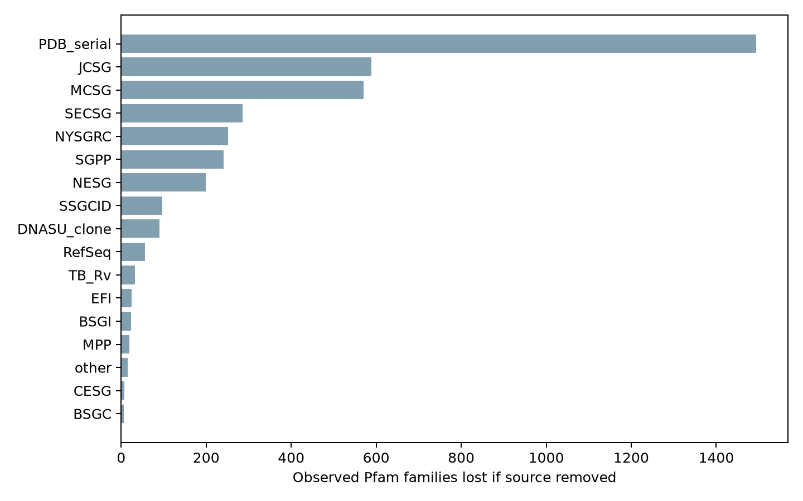

# Source contribution and biological diversity — 2026-11-12

**The operational cohort remains 13,880 proteins, 6,043 Pfam families, 557 clans and 13,716 detected homology groups.** Removing a source can remove real biological diversity even when its solubility labels are unsuitable for a primary property readout. All measurements below refer to this cached cohort, not the full cleaned pool.

## Scope and counting

Pfam 37.0 GA-passing memberships and existing MMseqs2 groups are reused without changes. Each protein counts once in cohort totals; protein–family and protein–clan pairs are deduplicated. Multidomain proteins can occur in several membership rows, so family/clan percentages need not sum to 100%. Family membership is not full architecture. Groups use the existing 30% identity, 80% bilateral coverage, E≤0.001 criterion; these are operational diversity units, not guarantees of evolutionary or statistical independence. Training and validation groups are disjoint.

## Counts by source and original split

| center | split | n | n0 | n1 | groups | families | clans |
| --- | --- | --- | --- | --- | --- | --- | --- |
| BSGC | train | 15 | 7 | 8 | 15 | 24 | 10 |
| BSGC | validation | 0 | 0 | 0 | 0 | 0 | 0 |
| BSGI | train | 29 | 9 | 20 | 29 | 22 | 13 |
| BSGI | validation | 35 | 35 | 0 | 35 | 42 | 17 |
| CESG | train | 20 | 17 | 3 | 20 | 24 | 12 |
| CESG | validation | 0 | 0 | 0 | 0 | 0 | 0 |
| DNASU_clone | train | 334 | 35 | 299 | 332 | 322 | 99 |
| DNASU_clone | validation | 126 | 16 | 110 | 124 | 126 | 40 |
| EFI | train | 121 | 76 | 45 | 120 | 100 | 31 |
| EFI | validation | 92 | 71 | 21 | 91 | 52 | 17 |
| JCSG | train | 1639 | 832 | 807 | 1633 | 1116 | 230 |
| JCSG | validation | 890 | 269 | 621 | 887 | 711 | 177 |
| MCSG | train | 1718 | 561 | 1157 | 1707 | 1156 | 243 |
| MCSG | validation | 527 | 367 | 160 | 526 | 453 | 123 |
| MPP | train | 5 | 0 | 5 | 5 | 9 | 3 |
| MPP | validation | 57 | 57 | 0 | 57 | 74 | 30 |
| NESG | train | 464 | 279 | 185 | 459 | 471 | 125 |
| NESG | validation | 152 | 152 | 0 | 152 | 152 | 51 |
| NYSGRC | train | 913 | 696 | 217 | 905 | 764 | 166 |
| NYSGRC | validation | 384 | 384 | 0 | 383 | 329 | 98 |
| PDB_serial | train | 2138 | 0 | 2138 | 2137 | 2114 | 368 |
| PDB_serial | validation | 748 | 0 | 748 | 746 | 886 | 216 |
| RefSeq | train | 79 | 0 | 79 | 79 | 116 | 38 |
| RefSeq | validation | 32 | 0 | 32 | 32 | 49 | 18 |
| SECSG | train | 845 | 419 | 426 | 843 | 636 | 164 |
| SECSG | validation | 300 | 208 | 92 | 300 | 276 | 93 |
| SGPP | train | 1092 | 743 | 349 | 1080 | 535 | 142 |
| SGPP | validation | 455 | 361 | 94 | 454 | 230 | 79 |
| SSGCID | train | 399 | 182 | 217 | 398 | 435 | 139 |
| SSGCID | validation | 67 | 1 | 66 | 67 | 61 | 31 |
| TB_Rv | train | 46 | 16 | 30 | 46 | 44 | 21 |
| TB_Rv | validation | 100 | 53 | 47 | 100 | 126 | 52 |
| other | train | 23 | 12 | 11 | 23 | 35 | 16 |
| other | validation | 35 | 26 | 9 | 35 | 65 | 26 |

## Biological coverage and mixed-label support

| center | n | pfam_annotated | taxonomy_assigned | families | clans | mixed_families | family_source_pairs_both_splits_ge3 | Pfam_percent | taxonomy_percent |
| --- | --- | --- | --- | --- | --- | --- | --- | --- | --- |
| BSGC | 15 | 11 | 15 | 24 | 10 | 0 | 0 | 73.3333 | 100.0000 |
| BSGI | 64 | 44 | 15 | 64 | 30 | 0 | 0 | 68.7500 | 23.4375 |
| CESG | 20 | 17 | 3 | 24 | 12 | 1 | 0 | 85.0000 | 15.0000 |
| DNASU_clone | 460 | 400 | 1 | 405 | 109 | 30 | 0 | 86.9565 | 0.2174 |
| EFI | 213 | 203 | 100 | 130 | 37 | 25 | 0 | 95.3052 | 46.9484 |
| JCSG | 2529 | 1831 | 883 | 1547 | 285 | 297 | 3 | 72.4002 | 34.9150 |
| MCSG | 2245 | 1685 | 635 | 1405 | 264 | 273 | 1 | 75.0557 | 28.2851 |
| MPP | 62 | 57 | 7 | 82 | 30 | 1 | 0 | 91.9355 | 11.2903 |
| NESG | 616 | 542 | 147 | 555 | 137 | 45 | 0 | 87.9870 | 23.8636 |
| NYSGRC | 1297 | 1006 | 667 | 955 | 201 | 124 | 0 | 77.5636 | 51.4264 |
| PDB_serial | 2886 | 2547 | 2187 | 2682 | 402 | 0 | 0 | 88.2536 | 75.7796 |
| RefSeq | 111 | 102 | 2 | 161 | 47 | 0 | 0 | 91.8919 | 1.8018 |
| SECSG | 1145 | 708 | 969 | 834 | 198 | 93 | 0 | 61.8341 | 84.6288 |
| SGPP | 1547 | 761 | 618 | 666 | 165 | 111 | 0 | 49.1920 | 39.9483 |
| SSGCID | 466 | 391 | 76 | 475 | 150 | 51 | 0 | 83.9056 | 16.3090 |
| TB_Rv | 146 | 110 | 37 | 159 | 61 | 6 | 0 | 75.3425 | 25.3425 |
| other | 58 | 52 | 24 | 99 | 38 | 2 | 0 | 89.6552 | 41.3793 |

The exact species-consensus taxonomy annotation is independent of the centre proxy. Low coverage is substantial and source-dependent: only 1/460 DNASU-proxy proteins has a consensus assignment in the current exact full-sequence procedure. This is an annotation limitation, not evidence of low organism diversity. Ambiguous taxonomic matches, engineered taxa and unmatched proteins remain distinct in [taxonomy_coverage.tsv](source_audit_results/taxonomy_coverage.tsv).

## Marginal contribution: remove one source, retain everything else

Losses below are observed set differences on the combined cohort. A family can remain present but cease to have both labels, hence loss of mixed-family support differs from loss of a family. Family × source opportunities disappear with the removed source even when other sources still contain the family.

| center | removed_n | unique_families_lost | unique_clans_lost | groups_lost | lost_mixed_families | lost_mixed_family_source_pairs | lost_family_source_pairs_both_splits_ge3 |
| --- | --- | --- | --- | --- | --- | --- | --- |
| BSGC | 15 | 6 | 0 | 15 | 3 | 0 | 0 |
| BSGI | 64 | 23 | 0 | 63 | 10 | 0 | 0 |
| CESG | 20 | 8 | 1 | 18 | 7 | 1 | 0 |
| DNASU_clone | 460 | 90 | 2 | 447 | 50 | 30 | 0 |
| EFI | 213 | 24 | 0 | 203 | 28 | 25 | 0 |
| JCSG | 2529 | 589 | 18 | 2491 | 286 | 297 | 3 |
| MCSG | 2245 | 570 | 17 | 2200 | 245 | 273 | 1 |
| MPP | 62 | 19 | 1 | 61 | 15 | 1 | 0 |
| NESG | 616 | 199 | 4 | 599 | 117 | 45 | 0 |
| NYSGRC | 1297 | 251 | 3 | 1264 | 189 | 124 | 0 |
| PDB_serial | 2886 | 1494 | 63 | 2845 | 293 | 0 | 0 |
| RefSeq | 111 | 56 | 1 | 104 | 11 | 0 | 0 |
| SECSG | 1145 | 286 | 12 | 1130 | 129 | 93 | 0 |
| SGPP | 1547 | 241 | 7 | 1524 | 150 | 111 | 0 |
| SSGCID | 466 | 97 | 2 | 448 | 88 | 51 | 0 |
| TB_Rv | 146 | 33 | 1 | 142 | 26 | 6 | 0 |
| other | 58 | 16 | 1 | 58 | 12 | 2 | 0 |

PDB_serial contributes **1,494 exclusive families, 63 exclusive clans and 2,845 groups absent from all other sources**; it also supplies one side of 293 otherwise-lost mixed-label families. This biological value supports retaining its sequences for concept analysis; it does not turn structure-selected positives into standardized solubility measurements. RefSeq adds 56 exclusive families despite being positive-only. These observations rule out class imbalance alone as an exclusion criterion.

## JCSG and MCSG: complementary, not interchangeable

| source_a | source_b | shared_families | family_jaccard | a_only_families | b_only_families | shared_groups | exact_sequence_overlap | shared_bio_cells |
| --- | --- | --- | --- | --- | --- | --- | --- | --- |
| JCSG | MCSG | 449 | 0.1794 | 1098 | 956 | 10 | 0 | 125 |

Across both splits, their family union is **2,503**, with **449 shared families**, **1,098 JCSG-only** and **956 MCSG-only** relative to each other. Only **10 detected homology groups** span the two sources, and no exact sequence is shared. The previously reported 322-family intersection used training only; the population here includes validation and is explicitly different.

Together they retain 4,774 proteins, 4,743 groups and 582 mixed-label families, but only ten families have ≥3/class in both splits; requiring the same centre leaves four family/centre pairs. Those pairs involve related methyltransferase Pfams and are not four independent biological mechanisms. Under the existing no-clan-competition annotation sensitivity, previous analysis found no such robust pairs. These centre choices do not fix label validity.

## Biochemical coverage, composition and construct observations

The complete [source × split × label descriptor table](source_audit_results/source_label_descriptors.tsv) reports length, charge proxy, KD hydropathy, entropy, all 20 amino-acid fractions, terminal His/cleavage/linker flags, non-M starts, repeated IDs, annotation coverage and existing APR/disorder/TM predictions. Missing predictions remain missing; a motif flag is an observation, not proof of an expression tag or truncated construct. Means and 5th/50th/95th percentiles are supplied without selecting features by label association.

A prespecified 3D grid uses training-fitted quintiles of log full length, charge proxy and KD hydropathy. No single source removal eliminates an occupied coarse cell: other sources span that coarse range. This is a limitation of a low-resolution coverage measure, not evidence that distributions or biological diversity are unchanged.

A complementary 21-dimensional comparison uses full-sequence AA fractions and log length, standardized on training only. For every protein in the removed source, measure the nearest retained protein outside its MMseqs group, compared with its nearest different-group neighbour before removal. The table describes geometry in this chosen descriptor space, not a universal biological distance.

| center | n | baseline_nearest_other_group_median | retained_nearest_other_group_median | increase_p95 | fraction_distance_increased |
| --- | --- | --- | --- | --- | --- |
| BSGC | 15 | 2.3735 | 2.3735 | 0.0000 | 0.0000 |
| BSGI | 64 | 2.7582 | 2.7582 | 0.0000 | 0.0000 |
| CESG | 20 | 2.5628 | 2.5628 | 0.0000 | 0.0000 |
| DNASU_clone | 460 | 2.6696 | 2.7147 | 0.2001 | 0.0978 |
| EFI | 213 | 2.0872 | 2.1279 | 0.1876 | 0.1033 |
| JCSG | 2529 | 2.4610 | 2.5170 | 0.3686 | 0.2855 |
| MCSG | 2245 | 2.4789 | 2.5099 | 0.2638 | 0.2232 |
| MPP | 62 | 2.1503 | 2.1574 | 0.0000 | 0.0484 |
| NESG | 616 | 2.3027 | 2.3229 | 0.1745 | 0.1185 |
| NYSGRC | 1297 | 2.2594 | 2.3048 | 0.4185 | 0.2421 |
| PDB_serial | 2886 | 2.6331 | 2.6694 | 0.4143 | 0.2751 |
| RefSeq | 111 | 2.4860 | 2.4860 | 0.0030 | 0.0541 |
| SECSG | 1145 | 2.4627 | 2.5040 | 0.3528 | 0.2725 |
| SGPP | 1547 | 2.2818 | 2.4799 | 0.7414 | 0.5507 |
| SSGCID | 466 | 2.2473 | 2.2651 | 0.0933 | 0.0880 |
| TB_Rv | 146 | 2.5365 | 2.5432 | 0.1885 | 0.1301 |
| other | 58 | 2.1684 | 2.1684 | 0.0000 | 0.0345 |

SGPP shows the largest affected fraction (about 55%), consistent with a distinctive sampled biochemical distribution. Zero median distance increase in several sources does not imply no tail losses: source-specific families and upper-tail neighbour distances still change. The feature axes and scale are fixed without labels.

## Named family distribution by source

The three most prevalent memberships per source are shown below. All family/clan counts and percentages, including long tails, are in [source_family_clan_distribution.tsv](source_audit_results/source_family_clan_distribution.tsv). Selection here uses source-wise frequency for description, not solubility association.

| center | accession | name | proteins | denominator |
| --- | --- | --- | --- | --- |
| BSGC | PF00949 | Peptidase S7, Flavivirus NS3 serine protease  | 2 | 15 |
| BSGC | PF01732 | Mycoplasma peptidase (DUF31) | 2 | 15 |
| BSGC | PF00535 | Glycosyl transferase family 2 | 1 | 15 |
| BSGI | PF00266 | Aminotransferase class-V | 2 | 64 |
| BSGI | PF00117 | Glutamine amidotransferase class-I | 1 | 64 |
| BSGI | PF00149 | Calcineurin-like phosphoesterase | 1 | 64 |
| CESG | PF00173 | Cytochrome b5-like Heme/Steroid binding domain | 2 | 20 |
| CESG | PF00021 | u-PAR/Ly-6 domain | 1 | 20 |
| CESG | PF00068 | Phospholipase A2 | 1 | 20 |
| DNASU_clone | PF00535 | Glycosyl transferase family 2 | 12 | 460 |
| DNASU_clone | PF10111 | Glycosyltransferase like family 2 | 8 | 460 |
| DNASU_clone | PF13641 | Glycosyltransferase like family 2 | 8 | 460 |
| EFI | PF01547 | Bacterial extracellular solute-binding protein | 36 | 213 |
| EFI | PF13416 | Bacterial extracellular solute-binding protein | 29 | 213 |
| EFI | PF00043 | Glutathione S-transferase, C-terminal domain | 17 | 213 |
| JCSG | PF08241 | Methyltransferase domain | 32 | 2529 |
| JCSG | PF13649 | Methyltransferase domain | 31 | 2529 |
| JCSG | PF00583 | Acetyltransferase (GNAT) family | 26 | 2529 |
| MCSG | PF00583 | Acetyltransferase (GNAT) family | 40 | 2245 |
| MCSG | PF01381 | Helix-turn-helix | 35 | 2245 |
| MCSG | PF08448 | PAS fold | 30 | 2245 |
| MPP | PF00153 | Mitochondrial carrier protein | 6 | 62 |
| MPP | PF01926 | 50S ribosome-binding GTPase | 4 | 62 |
| MPP | PF05347 | Complex 1 protein (LYR family) | 3 | 62 |
| NESG | PF13450 | NAD(P)-binding Rossmann-like domain | 15 | 616 |
| NESG | PF10604 | Polyketide cyclase / dehydrase and lipid transport | 12 | 616 |
| NESG | PF01844 | HNH endonuclease | 11 | 616 |
| NYSGRC | PF13649 | Methyltransferase domain | 61 | 1297 |
| NYSGRC | PF08241 | Methyltransferase domain | 57 | 1297 |
| NYSGRC | PF00535 | Glycosyl transferase family 2 | 54 | 1297 |
| PDB_serial | PF00583 | Acetyltransferase (GNAT) family | 20 | 2886 |
| PDB_serial | PF00076 | RNA recognition motif | 19 | 2886 |
| PDB_serial | PF13649 | Methyltransferase domain | 14 | 2886 |
| RefSeq | PF00037 | 4Fe-4S binding domain | 3 | 111 |
| RefSeq | PF00165 | Bacterial regulatory helix-turn-helix proteins, AraC family | 3 | 111 |
| RefSeq | PF12833 | Helix-turn-helix domain | 3 | 111 |
| SECSG | PF00069 | Protein kinase domain | 15 | 1145 |
| SECSG | PF07714 | Protein tyrosine and serine/threonine kinase | 13 | 1145 |
| SECSG | PF00076 | RNA recognition motif | 8 | 1145 |
| SGPP | PF00069 | Protein kinase domain | 28 | 1547 |
| SGPP | PF00076 | RNA recognition motif | 27 | 1547 |
| SGPP | PF07714 | Protein tyrosine and serine/threonine kinase | 25 | 1547 |
| SSGCID | PF00069 | Protein kinase domain | 24 | 466 |
| SSGCID | PF07714 | Protein tyrosine and serine/threonine kinase | 24 | 466 |
| SSGCID | PF00240 | Ubiquitin family | 23 | 466 |
| TB_Rv | PF00934 | PE family | 5 | 146 |
| TB_Rv | PF08241 | Methyltransferase domain | 5 | 146 |
| TB_Rv | PF13489 | Methyltransferase domain | 5 | 146 |
| other | PF01850 | PIN domain | 4 | 58 |
| other | PF00501 | AMP-binding enzyme | 2 | 58 |
| other | PF00550 | Phosphopantetheine attachment site | 2 | 58 |

## Reproduction and limitations

Run `source_validity_audit.py --stage diversity`, then the record-recovery scripts and `source_audit_supplement.py`, then `render_source_audit.py`. Fixed protocol and input hashes are in source_audit_results/. Coarse cells and nearest-neighbour measurements are descriptive; source-removal estimates mix source size with unique contribution and are not a ranking of source quality. Counts are observed in this development sample, not the entire originating programme. No annotation, clustering or embedding extraction was rerun.
