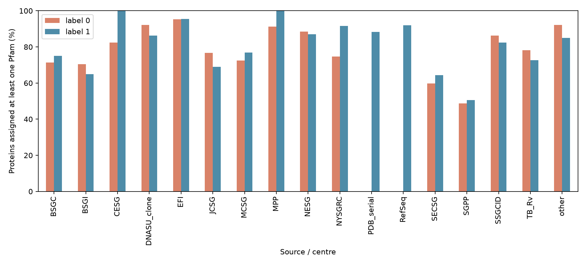

# Uniform Pfam annotation and controlled-analysis feasibility

All **13,880** frozen cached-cohort proteins were searched against **21,979 Pfam 37.0 profiles**, using pinned **PyHMMER 0.11.2** and the per-profile sequence/domain gathering thresholds. All input sequences, labels, original split roles and homology-cluster assignments were preserved. No protein was selected by label, source, prior annotation or model performance. The locked test was never read.

**Coverage:** 10,467/13,880 proteins (75.41%) have at least one GA-passing domain, spanning **6,043 observed Pfam accessions**. **1,660 families contain both labels** across development. This replaces the pilot-only feasibility limitation; the old pilot report remains a historical snapshot.

## Primary cohort and interpretation

Keep **A: all 9,880 training + 4,000 validation proteins** as the heterogeneous primary experiment, including single-class families and searched/no-hit records. Use B as a controlled evaluation on family strata derived from that same A cohort. Do not rebalance family distributions or train the primary property probe only on B. The cohort was frozen before this annotation run; no AUROC was computed or consulted.

At **≥3 proteins per class in training**, 257 families qualify; 164 also have both labels in validation. Of these, 69 meet ≥3 per class separately in **both splits**, and 65 also meet that threshold using class-exclusive detected homology groups in each split. Same-source matching leaves 22 training-supported family × source pairs with both validation classes, including 4 pairs meeting the threshold in both splits.

At **≥5 proteins per class in training**, 116 families qualify; 92 also have both labels in validation. Of these, 23 meet ≥5 per class separately in **both splits**, and 22 also meet that threshold using class-exclusive detected homology groups in each split. Same-source matching leaves 10 training-supported family × source pairs with both validation classes, including 0 pairs meeting the threshold in both splits.

**B is now feasible as an exploratory within-Pfam contrast**, with the strongest candidates requiring support in both splits and within the same source. Feasibility is not a power calculation or proof of reliable biochemical solubility labels. A shared Pfam domain does not establish identical whole-protein architecture, organism, construct or assay.

**The source-matched version is much less secure:** after removing competing clan-overlap assignments, only 10 families retain ≥3 per class in both splits and 3 retain ≥5; no same-source pair reaches either threshold in both splits. This sensitivity is conservative rather than official clan resolution, but it shows that the nominal same-source support is annotation-dependent.

## Annotation coverage and missingness

All records were attempted successfully. `searched_no_GA_hit` means no domain met the pinned profile thresholds; it does not prove absence of a biological family. There are no unqueried records and no failed searches hidden as no-hit outcomes. Full sequences were annotated even when the cached ESM representation sees only the first 1,022 residues.

| split | label | n | assigned | no_hit | coverage_percent |
| --- | --- | --- | --- | --- | --- |
| train | 0 | 3884 | 2748 | 1136 | 70.75 |
| train | 1 | 5996 | 4779 | 1217 | 79.7 |
| validation | 0 | 2000 | 1405 | 595 | 70.25 |
| validation | 1 | 2000 | 1535 | 465 | 76.75 |

Source × label coverage (training and validation pooled here; split-specific counts are saved):

| source | label0: assigned/total | label1: assigned/total |
| --- | --- | --- |
| BSGC | 5/7 (71.4%) | 6/8 (75.0%) |
| BSGI | 31/44 (70.5%) | 13/20 (65.0%) |
| CESG | 14/17 (82.4%) | 3/3 (100.0%) |
| DNASU_clone | 47/51 (92.2%) | 353/409 (86.3%) |
| EFI | 140/147 (95.2%) | 63/66 (95.5%) |
| JCSG | 845/1101 (76.7%) | 986/1428 (69.0%) |
| MCSG | 672/928 (72.4%) | 1013/1317 (76.9%) |
| MPP | 52/57 (91.2%) | 5/5 (100.0%) |
| NESG | 381/431 (88.4%) | 161/185 (87.0%) |
| NYSGRC | 807/1080 (74.7%) | 199/217 (91.7%) |
| PDB_serial | — | 2547/2886 (88.3%) |
| RefSeq | — | 102/111 (91.9%) |
| SECSG | 375/627 (59.8%) | 333/518 (64.3%) |
| SGPP | 537/1104 (48.6%) | 224/443 (50.6%) |
| SSGCID | 158/183 (86.3%) | 233/283 (82.3%) |
| TB_Rv | 54/69 (78.3%) | 56/77 (72.7%) |
| other | 35/38 (92.1%) | 17/20 (85.0%) |

There are 19,347 retained domain instances; repeat copies count once toward each protein–family membership. 2,381 proteins have competing overlapping different-family hits within the same clan. Primary annotation retains GA-passing evidence; a conservative sensitivity removes both competing alternatives. Clans never substitute for Pfam families.

## Family and homology-group support

Pooled-development counts below describe available family diversity; they do **not** select B families. B eligibility uses training counts, and validation support is reported separately. Protein totals are unions across qualifying families, avoiding double-counting multidomain proteins.

| threshold | families | proteins | all groups | label 0 groups | label 1 groups |
| --- | --- | --- | --- | --- | --- |
| 3 | 395 | 4187 | 4120 | 1985 | 2189 |
| 5 | 205 | 3089 | 3041 | 1495 | 1584 |

Training-selected families with both validation classes:

| k | training_eligible | training_eligible_val_both | both_splits_threshold | eval_eligible_unique_proteins | eval_eligible_val_proteins | eval_eligible_groups0 | eval_eligible_groups1 |
| --- | --- | --- | --- | --- | --- | --- | --- |
| 3 | 257 | 164 | 69 | 2732 | 873 | 1345 | 1378 |
| 5 | 116 | 92 | 23 | 2156 | 674 | 1102 | 1046 |

`family_support.tsv` gives each family's per-class protein counts, distinct groups per class, groups shared across labels, class-exclusive groups, source counts and split support. Group counts are not summed across families. A group appearing under both labels is shared, not two independent observations. Detected MMseqs2 groups are operational independence units, not guarantees against remote homology; their existing 30%-identity/80%-bilateral-coverage definition is unchanged. No group spans training and validation in this cohort. Qualifying family counts based on class-exclusive groups are a conservative secondary support check.

Examples below have ≥5 training proteins per label and ≥3 validation proteins per label, ordered by validation minority-class count, **not model performance**. These are illustrations, not a selected replacement for A or the complete B membership list.

| pfam | n0_train | n1_train | groups0_train | groups1_train | n0_val | n1_val | groups0_val | groups1_val |
| --- | --- | --- | --- | --- | --- | --- | --- | --- |
| PF13649 | 37 | 32 | 37 | 32 | 62 | 20 | 62 | 20 |
| PF08241 | 34 | 36 | 34 | 36 | 58 | 17 | 58 | 17 |
| PF13489 | 31 | 24 | 31 | 24 | 44 | 14 | 44 | 14 |
| PF13847 | 26 | 21 | 26 | 21 | 42 | 12 | 42 | 12 |
| PF08242 | 29 | 22 | 29 | 22 | 36 | 10 | 36 | 10 |
| PF00535 | 31 | 18 | 31 | 18 | 26 | 9 | 26 | 9 |
| PF00069 | 53 | 25 | 53 | 25 | 22 | 8 | 22 | 8 |
| PF00076 | 18 | 30 | 18 | 30 | 8 | 8 | 8 | 8 |
| PF00578 | 21 | 5 | 21 | 5 | 11 | 8 | 11 | 8 |
| PF07714 | 51 | 22 | 51 | 22 | 19 | 8 | 19 | 8 |
| PF08534 | 20 | 5 | 20 | 5 | 10 | 8 | 10 | 8 |
| PF13641 | 22 | 10 | 22 | 10 | 14 | 8 | 14 | 8 |

## Same-source contrasts and label reliability

Same-source eligibility requires the threshold in the **same Pfam × source stratum in training**, then evaluates validation support in that stratum. Source counts below refer to unique proteins within the union of such minimally evaluable strata; a protein may be in multiple family strata, but contributes once per source/split/label cell.

| center | label | n_proteins | n_groups |
| --- | --- | --- | --- |
| JCSG | 0 | 33 | 33 |
| JCSG | 1 | 22 | 22 |
| MCSG | 0 | 39 | 39 |
| MCSG | 1 | 58 | 58 |
| SECSG | 0 | 9 | 9 |
| SECSG | 1 | 6 | 6 |

Same-source pairs meeting ≥3 proteins per class in both original splits:

| pfam | center | n0_train | n1_train | groups0_train | groups1_train | n0_val | n1_val | groups0_val | groups1_val |
| --- | --- | --- | --- | --- | --- | --- | --- | --- | --- |
| PF08241 | JCSG | 18 | 4 | 18 | 4 | 5 | 5 | 5 | 5 |
| PF13489 | JCSG | 15 | 3 | 15 | 3 | 4 | 4 | 4 | 4 |
| PF13649 | JCSG | 17 | 4 | 17 | 4 | 5 | 5 | 5 | 5 |
| PF13649 | MCSG | 4 | 11 | 4 | 11 | 3 | 4 | 3 | 4 |

The four nominal ≥3-per-class pairs involve PF08241, PF13489 and PF13649: related methyltransferase models in clan CL0063 (NADP_Rossmann). Their overlapping memberships are correlated annotation hypotheses, not four independent replications. None survives the conservative competing-domain exclusion at the same support threshold. Clan information is used to diagnose ambiguity, never to merge these into a single substitute family.

| k | same_source_training_pairs | same_source_val_both_pairs | same_source_both_splits_threshold_pairs | same_source_eval_unique_proteins | same_source_eval_val_proteins | same_source_eval_unique_groups |
| --- | --- | --- | --- | --- | --- | --- |
| 3 | 81 | 22 | 4 | 267 | 65 | 267 |
| 5 | 30 | 10 | 0 | 167 | 36 | 167 |

Record-level experimental reliability is **unchanged and unverified for every record**. TargetTrack/SG statuses can encode workflow progress rather than confirmed insolubility; PDB records are structure-selected positives; DNASU-like records are candidates for explicit-status recovery but those statuses have not been recovered. Same-centre comparisons reduce a provenance shortcut without certifying comparable assay conditions. `family_label_reliability.tsv` gives the source × label distribution and reliability category inside each family; `family_source_support.tsv` contains the per-class group counts for every source stratum. Pure-positive sources can contribute to A and pooled family diversity but cannot independently supply a two-class B contrast.

## Fixed quality sensitivities

Domain-quality policies retain all A proteins and change usable family memberships only. Cohort-quality policies are diagnostic subsets, not alternate primary cohorts selected for performance. A stricter filter can lose power or preferentially remove one label; counts must be read alongside its source/label coverage table.

| policy | k | n_cohort | annotated_proteins | mixed_families | pooled_qualifying | training_eligible_val_both | both_splits_threshold | same_source_both_splits_threshold_pairs |
| --- | --- | --- | --- | --- | --- | --- | --- | --- |
| GA_all | 3 | 13880 | 10467 | 1660 | 395 | 164 | 69 | 4 |
| GA_all | 5 | 13880 | 10467 | 1660 | 205 | 92 | 23 | 0 |
| GA_hmm_coverage_80pct | 3 | 13880 | 8799 | 1307 | 268 | 105 | 45 | 3 |
| GA_hmm_coverage_80pct | 5 | 13880 | 8799 | 1307 | 133 | 60 | 12 | 0 |
| GA_without_clan_competition | 3 | 13880 | 8763 | 1226 | 177 | 49 | 10 | 0 |
| GA_without_clan_competition | 5 | 13880 | 8763 | 1226 | 61 | 22 | 3 | 0 |
| GA_domains_visible_to_ESM | 3 | 13880 | 10449 | 1646 | 390 | 161 | 69 | 4 |
| GA_domains_visible_to_ESM | 5 | 13880 | 10449 | 1646 | 201 | 90 | 21 | 0 |
| source_controlled | 3 | 10058 | 7127 | 1223 | 286 | 104 | 30 | 4 |
| source_controlled | 5 | 10058 | 7127 | 1223 | 133 | 63 | 6 | 0 |
| no_terminal_artifact_flags | 3 | 12923 | 9643 | 1578 | 369 | 150 | 60 | 4 |
| no_terminal_artifact_flags | 5 | 12923 | 9643 | 1578 | 189 | 89 | 22 | 0 |
| within_ESM_context | 3 | 13662 | 10282 | 1612 | 376 | 156 | 63 | 4 |
| within_ESM_context | 5 | 13662 | 10282 | 1612 | 196 | 89 | 21 | 0 |

Under the conservative no-clan-competition policy, the three families with ≥5 proteins per label in both splits are PF00076, PF00400 and PF04055. These remain cross-source candidates, not verified same-assay comparisons.

The 80% HMM-span filter assesses partial-domain evidence, not homology coverage. The clan-competition sensitivity excludes both different-family same-clan hits with overlapping aligned residues; it is conservative and can remove legitimate nested domains. It is not presented as official PfamScan post-processing. The ESM-visible-domain policy requires alignment end ≤1,022; it avoids assigning a family based solely on a domain outside the cached input. Tags remain intact in the primary sequences.

## Reproducibility and next experiment

Follow [PFAM_METHODS.md](PFAM_METHODS.md) for the pinned reference URLs, checksums, package versions and exact search thresholds. `search_run.json` verifies all 21,979 profiles completed against all 13,880 sequences. `profile_thresholds.tsv` preserves each versioned accession and its sequence/domain cutoffs; `domains.tsv` preserves coordinates, scores and E-values. `annotated_cohort.tsv` includes no-hit rows; `memberships.tsv` records individual Pfam memberships. `analysis_B_memberships.tsv` links training-eligible strata back to A and flags validation and same-source evaluability. `training_selected_families.tsv` records support in both splits without changing split roles.

Next, fit property/concept models on the heterogeneous A training set and evaluate property predictions within the predefined B strata. Report all per-family/source counts, family-macro results, and uncertainty using detected homology groups as resampling units; account for proteins belonging to several Pfam strata. Use the ≥3 and ≥5 requirements as declared sensitivity levels, not a search over model outcomes. No representation probe was run for this annotation task. Solubility conclusions remain exploratory until original experimental outcomes are verified.

The old pilot-based report correctly described the evidence then available; this uniform run supersedes its zero-support conclusion. Original datasets, old analyses, family/split assignments and the locked test remain preserved.
